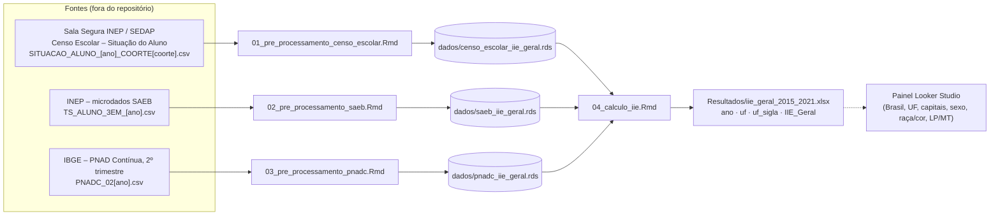

# 03 — Arquitetura técnica

> Levantamento feito em 2026-09-10 sobre o commit `60e7bfb` (branch `main`).
> Fontes: leitura integral dos quatro notebooks `.Rmd`, do `README.md`, das imagens em `imgs/`, inspeção das três bases `.rds` e indexação do repositório com GitNexus 1.6.11.

## 1. Visão geral

O repositório é um **pipeline analítico em R Markdown**, não uma aplicação. Não há pacote R, `renv`, testes automatizados, CI nem servidor. São quatro notebooks executados manualmente, em ordem, que transformam microdados públicos e restritos em um índice por UF.

```
iie-indice-de-inclusao-educacional/
├── README.md                     # descrição pública do IIE e do fluxo
├── codigos_iie/                  # pipeline (R Markdown)
│   ├── 01_pre_processamento_censo_escolar.Rmd   # Censo Escolar → trajetórias da coorte
│   ├── 02_pre_processamento_saeb.Rmd            # SAEB 3º EM → básico × abaixo, por trajetória
│   ├── 03_pre_processamento_pnadc.Rmd           # PNADc 2º tri → % fora da escola sem EM
│   └── 04_calculo_iie.Rmd                       # integra as três bases e calcula o IIE
├── dados/                        # bases intermediárias agregadas (insumo do script 04)
│   ├── censo_escolar_iie_geral.rds
│   ├── saeb_iie_geral.rds
│   └── pnadc_iie_geral.rds
├── estudos/                      # 4 estudos em PDF produzidos com o IIE
├── imgs/                         # figuras da metodologia usadas no README
│   ├── fluxo_bases.png  calculo.png  tabela.png
└── contexto/                     # ← esta documentação
```

| Item | Valor |
|---|---|
| Linguagem | R (tidyverse), em notebooks R Markdown (`html_document`) |
| Pacotes | `tidyverse` (dplyr, tidyr, purrr, readr, stringr), `glue`, `readr`, `writexl`, `knitr` |
| Versões de pacotes | não fixadas (sem `renv.lock` / `DESCRIPTION`) |
| Formato dos insumos brutos | CSV com separador `;`, lidos com `readr::read_delim` |
| Formato intermediário | `.rds` (preserva tipos entre scripts) |
| Saída final | `.xlsx` via `writexl::write_xlsx` |
| Autoria declarada | "Lupa Social" (cabeçalho YAML dos quatro `.Rmd`); o script 04 cita a metodologia "da Lupa Social e Instituto Natura" |

## 2. Fluxo de dados



- Os scripts 01–03 são **independentes entre si** e podem rodar em qualquer ordem; o 04 depende dos três.
- Só o 04 é reproduzível com o que está no repositório (as bases `.rds` já vêm prontas). Os scripts 01–03 exigem os microdados brutos, que não estão versionados. O 01 exige ainda acesso autorizado à Sala Segura do INEP.
- As bases brutas do Censo ficam fora do Git por decisão explícita (`.gitignore`: `**/bases intermediárias extraídas da Sedap/`).

## 3. Scripts em detalhe

### 3.1 `01_pre_processamento_censo_escolar.Rmd` — trajetórias da coorte

**Unidade de análise:** matrícula. **Objetivo:** contar, por UF, quantos nascidos no ano da coorte concluíram o 3º ano do EM adiantados, em linha ou com 1 ano de atraso, e quantos ainda estavam no sistema sem concluir.

Parâmetros (`chunk parametros`):

| Constante | Valor | Significado |
|---|---|---|
| `BASE_DIR` | `"../../Dados"` | pasta com os CSVs extraídos da Sala Segura |
| `cod_3o_em` | `27, 28, 32, 33, 37, 38` | etapas terminais do EM: 3ª e 4ª séries do EM regular, do técnico integrado e do normal/magistério |
| `excluir_etp` | `29, 34, 39, 40` | etapas excluídas: EM não seriado, integrado não seriado, técnico concomitante e subsequente |
| filtro `tp_etapa_ensino < 65` | — | remove EJA, FIC e afins |
| `aprovado` | `5` | código de `tp_situacao` = aprovado |
| `ano_iie_map` | 1998→2015, 2000→2017, 2002→2019, 2004→2021 | coorte (ano de nascimento) → ano de referência do IIE (coorte + 17) |
| `map_coorte_anos` | `tm1 = t−1`, `t`, `tp1 = t+1` | os três anos do Censo lidos para cada coorte |

> Os significados dos códigos de etapa seguem o dicionário do Censo Escolar do INEP válido até 2022. O comentário no código ("ex: EJA/Profissionalizante específico") é impreciso: confirme os códigos no dicionário da edição usada.

Funções:

| Função | O que faz |
|---|---|
| `uf_to_regiao(uf)` | código IBGE da UF → grande região (`0` → "Brasil") |
| `filter_base_censo(df)` | remove etapa nula, etapas excluídas e etapas ≥ 65 |
| `em3_aprov(df)` | `filter_base_censo` + etapa em `cod_3o_em` + `tp_situacao == 5` |
| `processa_censo_coorte(coorte, anos)` | lê `SITUACAO_ALUNO_{ano}_COORTE{coorte}.csv` para t−1, t e t+1 e monta os 4 grupos (abaixo) |

Regras de classificação em `processa_censo_coorte`:

| Grupo (`grupo`) | Regra | Idade de conclusão |
|---|---|---|
| `coorte_adiantado_Censo` | aprovados em etapa terminal no ano **t−1** | ≤ 16 anos |
| `coorte_emlinha_Censo` | aprovados em etapa terminal no ano **t** | 17 anos |
| `coorte_atrasado_Censo` | aprovados em etapa terminal no ano **t+1** | 18 anos |
| `coorte_atrasado2_Censo` | matrículas da coorte em t+1 (`filter_base_censo`) **menos** os aprovados em t+1 | ainda não concluiu aos 18 → atraso ≥ 2 |

Execução: `purrr::imap_dfr` sobre as coortes; soma nacional como `uf = 0`; `saveRDS("../Dados/censo_escolar_iie_geral.rds")`.

Pré-requisito implícito: cada CSV já vem **filtrado pela coorte de nascimento** na extração da Sala Segura (o nome do arquivo carrega a coorte). O script não filtra por idade.

### 3.2 `02_pre_processamento_saeb.Rmd` — proficiência por trajetória

**Objetivo:** para cada UF e trajetória idade-série, somar (com peso amostral) os alunos do 3º EM **básico** (LP ≥ 300 **e** MT ≥ 300) e **abaixo** (LP < 300 **ou** MT < 300).

| Função | O que faz |
|---|---|
| `uf_to_regiao(uf)` | igual ao 01 |
| `normalize_uf_saeb(df)` | minúsculas nos nomes; usa `uf` ou `id_uf` como código da UF |
| `map_idade_serie_saeb(df, var_idade)` | resposta de idade (2015/2017): A/B → adiantado, C → linha, D → atrasado, E–H → atrasado2 |
| `processa_saeb_historico(ano)` | 2015, 2017 e 2019. Filtra LP e MT não nulos. Peso = `peso_aluno_lp`. Em 2015/2017 agrupa por UF × trajetória (`tx_resp_q004`). **Em 2019 agrupa só por UF (`grupo = "total"`)**, porque os microdados públicos do SAEB 2019 não trazem a idade |
| `processa_saeb_2021()` | 2021. Idade em `tx_resp_q02` (1º caractere): A → adiantado, B → linha, C → atrasado, D–F → atrasado2 |

Consolidação: recodifica `atrasado → atrasado1ano` e `atrasado2 → atrasado2anos`; soma nacional (`uf = 0`); arredonda `valor`; `saveRDS("../Dados/saeb_iie_geral.rds")`.

### 3.3 `03_pre_processamento_pnadc.Rmd` — evasão aos 17 anos

**Objetivo:** estimar, por UF, a população da coorte (17 anos no ano de referência) e quantos estão **fora da escola sem EM**.

| Função | O que faz |
|---|---|
| `prep_coorte(df, ano_ref)` | minúsculas; converte `uf, v20082, v3002, v3009, v3009a, v3003, v3003a, v3013, v1028` para numérico; mantém quem nasceu em `ano_ref − 17` (`v20082`) |
| `classifica_pnadc(df)` | `v9 = coalesce(v3009a, v3009)`, `v3 = coalesce(v3003a, v3003)`; `hasA` indica o questionário novo (variáveis com sufixo `a`); classifica em `Fora_com_EM`, `Fora_sem_EM` ou `outros` (regras em [02_metodologia.md](02_metodologia.md#5-pnadc-quem-está-fora-da-escola-sem-em)); descarta registros com `v3002` nulo ou (`v3002 == 2` e `v9` nulo) |
| `processa_ano_pnadc(ano)` | lê `PNADC_02{ano}.csv`; soma `v1028` por UF × classe; gera `coorte_PNAD` (soma das três classes) e `coorte_fora_sem_EM_PNAD` |
| `if_error(x, val)` | helper para colunas ausentes após o `pivot_wider` — **defeituoso**, ver [07_lacunas_riscos_e_proximos_passos.md](07_lacunas_riscos_e_proximos_passos.md) |

Execução: anos 2015, 2017, 2019 e 2021; soma nacional (`uf = 0`); `saveRDS("../Dados/pnadc_iie_geral.rds")`.

Pré-requisito implícito: os quatro CSVs precisam ter **todas** as colunas listadas em `prep_coorte`, inclusive `v3009a`/`v3003a` no arquivo de 2015 (mesmo vazias). Caso contrário, o `across()` falha.

### 3.4 `04_calculo_iie.Rmd` — cálculo final

| Chunk | O que faz |
|---|---|
| `pacotes` | lê as três `.rds` de `../dados` |
| `funcoes_auxiliares` | `safe_div(a, b)` (retorna 0 se `b` for 0 ou não finito) e `uf_map` (código → sigla; `0 → "BR"`) |
| `calculo_regular` | anos 2015, 2017 e 2021: pivota o Censo (4 colunas de contagem), calcula `p_basico_{grupo}` no SAEB e `perc_fora` na PNADc, junta por `ano, uf` e calcula o IIE (fórmula em [02_metodologia.md](02_metodologia.md#6-fórmula-implementada)) |
| `calculo_2019` | chama `calc_iie_2019_geral(censo, saeb, pnadc)`. **Essa função não está definida em nenhum arquivo do repositório** |
| `consolidacao` | empilha os anos, junta a sigla, arredonda para 1 casa (`IIE_Geral`) |
| `exportacao` | `write_xlsx(..., "../Resultados/iie_geral_2015_2021.xlsx")` (pasta inexistente no repo) |

## 4. Convenções transversais

- **UF:** código IBGE de 2 dígitos; `0` = Brasil (soma das UFs, feita em cada pré-processamento).
- **Região:** derivada do 1º dígito do código (1 Norte, 2 Nordeste, 3 Sudeste, 4 Sul, 5 Centro-Oeste).
- **Chave de junção no script 04:** `(ano, uf)`, onde `ano` = ano de referência do IIE = coorte + 17.
- **Nomes de grupo** mudam entre as bases e são harmonizados no 04:

| Censo (`.rds`) | SAEB (`.rds`) | Coluna no 04 |
|---|---|---|
| `coorte_adiantado_Censo` | `adiantado` | `coorte_adiantado_censo` / `p_basico_adiantado` |
| `coorte_emlinha_Censo` | `linha` | `coorte_emlinha_censo` / `p_basico_emlinha` |
| `coorte_atrasado_Censo` | `atrasado1ano` | `coorte_atrasado_censo` / `p_basico_atrasado` |
| `coorte_atrasado2_Censo` | `atrasado2anos` | `coorte_atrasado2_censo` / `p_basico_atrasado2` (calculado, mas não entra no numerador) |

## 5. Caminhos de diretório esperados

Os scripts assumem que rodam de dentro de `codigos_iie/`:

| Script | Lê de | Grava em |
|---|---|---|
| 01, 02, 03 | `../../Dados/` (fora do repo) | `../Dados/*.rds` |
| 04 | `../dados/*.rds` | `../Resultados/iie_geral_2015_2021.xlsx` |

`../Dados` e `../dados` só são a mesma pasta em sistemas de arquivos que não diferenciam maiúsculas (padrão do macOS). No Linux, a gravação dos scripts 01–03 e a leitura do 04 apontam para pastas diferentes.

## 6. Como reproduzir

1. Instale R ≥ 4.1 e os pacotes: `install.packages(c("tidyverse", "glue", "writexl", "rmarkdown"))`.
2. Crie a pasta `Resultados/` na raiz do repositório.
3. Implemente ou obtenha `calc_iie_2019_geral()` (ou remova o chunk `calculo_2019`).
4. Na pasta `codigos_iie/`, rode `rmarkdown::render("04_calculo_iie.Rmd")`.

Com as bases versionadas hoje, a saída terá apenas **2015, 2017 e 2019** (este último só se a função de 2019 for implementada). A base do Censo não contém a coorte de 2004 (ano 2021). Ver [07_lacunas_riscos_e_proximos_passos.md](07_lacunas_riscos_e_proximos_passos.md).

Os números de 2015 e 2017 foram reproduzidos em Python a partir das `.rds` (script em [anexos/reproducao_iie.py](anexos/reproducao_iie.py); resultados em [05_resultados_por_territorio.md](05_resultados_por_territorio.md)).

## 7. Indexação com GitNexus

- Comando: `npx gitnexus analyze --skip-agents-md --skip-skills` (índice em `.gitnexus/`, já ignorado via `.git/info/exclude`).
- Resultado: **26 nós, 23 arestas, 0 clusters, 0 fluxos de execução.** O GitNexus 1.6.11 não interpreta R/R Markdown: o grafo contém só pastas, arquivos e as seções do `README.md`. Consultas como `gitnexus query` e `gitnexus context` não retornam símbolos nem fluxos.
- Consequência: para este repositório, a fonte de verdade técnica é a leitura direta dos `.Rmd` (este documento). O índice só ajuda na navegação por arquivos e seções do README.
