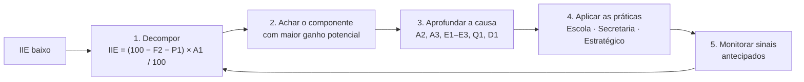
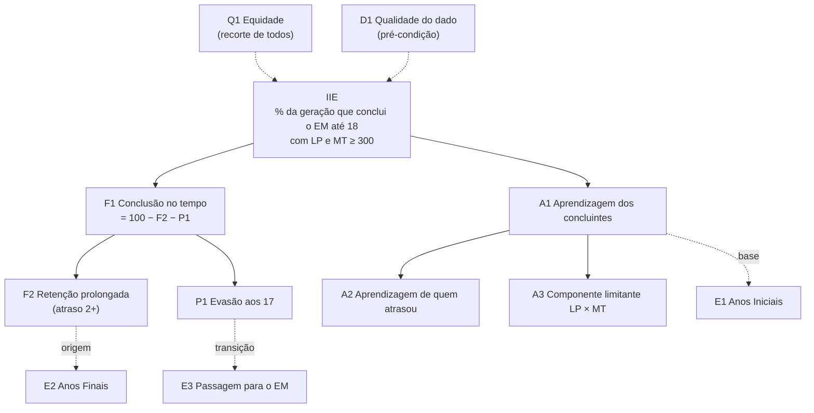

# 09 — Indicadores do IIE e práticas de gestão

Este documento cruza os componentes do IIE com três referenciais de boas práticas de gestão educacional presentes em [`boas-praticas/`](../boas-praticas/). A pergunta que ele responde: **se um indicador do IIE está baixo, quais práticas e ações de gestão executar, em que nível e com que prioridade?**

| Visão | Documento | Autor | Nível de atuação | Práticas inventariadas |
|---|---|---|---|---:|
| **Gestão Escolar** | *Referencial para Qualidade e Equidade da Gestão Escolar* (`referencial-gestao-escolar-mec.md`) | MEC, 2026 | diretor(a) e equipe gestora (6 dimensões, 22 subdimensões) + papel da Secretaria no acompanhamento das escolas | 279 (escola, GE-) + 93 (Secretaria, GE-SEC-) |
| **Gestão da Secretaria** | *Secretaria Municipal de Educação: Práticas para uma boa gestão* (`031_Secretaria…md`) | Fundação Itaú / Itaú Social, 2021 | secretaria municipal no início da gestão (4 eixos: equipe, funcionamento, ano letivo, plano estratégico) | 117 (SM-) |
| **Gestão Estratégica** | *Planejamento Estratégico de uma Secretaria de Educação* (`planejamento-estrategico-…md`) | Todos Pela Educação | ciclo de planejamento em 7 etapas (diagnóstico → metas → visão sistêmica → prioridades → plano → formalização → monitoramento) | 52 (PE-) |

Os IDs (GE-, GE-SEC-, SM-, PE-) seguem a ordem de aparição em cada documento. A coluna **Fonte** indica as linhas do arquivo `.md` correspondente. A matriz completa, legível por máquina, está em [anexos/matriz_indicador_pratica.csv](anexos/matriz_indicador_pratica.csv). O catálogo com todas as 541 práticas, inclusive as que não estão ligadas a indicadores, está em [anexos/catalogo_praticas.csv](anexos/catalogo_praticas.csv).

> **Quem executa.** O IIE mede o fim do Ensino Médio, oferta majoritária das **redes estaduais**. Os documentos do Itaú Social e do TPE foram escritos para **secretarias municipais**, e o do MEC vale para qualquer escola pública.
> - As práticas de secretaria valem, por analogia, para as redes estaduais nos indicadores do EM (P1, F2, A1, A2, E3).
> - As redes municipais atuam sobretudo na base: E1 e E2, o fluxo do EF (onde nasce o atraso 2+), a busca ativa e a transição para o EM.

---

## 1. Como usar

1. **Confira o dado (D1).** Uma quebra brusca entre coortes, como a da BA em 2019, invalida a leitura. Corrija antes de agir.
2. **Decomponha.** O IIE é, exatamente, o produto de fluxo e aprendizagem: **IIE = (100 − F2 − P1) × A1 / 100**. No Brasil em 2019: (100 − 31,0 − 6,4) × 29,8% ≈ 18,6 (oficial: 19,0).
3. **Priorize pelo ganho potencial:** quanto o IIE subiria se cada componente chegasse ao nível do Brasil (seção 3).
4. **Aplique o pacote do indicador** (seção 5): práticas-núcleo nos três níveis, com os complementares como reforço, sempre sobre a **base comum** (seção 6).
5. **Monitore os sinais antecipados.** O IIE responde com atraso (tabela abaixo). Frequência, reprovação, diagnósticas e IIE-AI/AF mostram antes se a ação está funcionando.

| Onde a prática atua | Quando aparece no IIE-EM |
|---|---|
| Ensino Médio (15–18 anos) | 0–3 anos (próximas 1–2 edições) |
| Anos Finais (11–14 anos) | 4–7 anos |
| Anos Iniciais e alfabetização (6–10 anos) | 8–11 anos |

## 2. Árvore de indicadores do IIE

| ID | Indicador | Pergunta | Brasil 2019 | 🟡 Atenção | 🔴 Crítico |
|---|---|---|---|---|---|
| **P1** | Evasão aos 17 anos | Quantos jovens da geração saíram da escola sem concluir o EM? | 6,4% | > 6,4% | > 9,8% |
| **F2** | Retenção prolongada (atraso 2+) | Quantos seguem matriculados aos 18 anos sem ter concluído o EM? | 31,0% | > 31,0% | > 37,9% |
| **F1** | Conclusão no tempo (até 18 anos) | Quantos concluem o EM até os 18 anos? | 62,6% | < 62,6% | < 53,3% |
| **A1** | Aprendizagem dos concluintes | Dos que concluem no tempo, quantos têm o básico em LP **e** MT (≥ 300)? | 29,8% | < 29,8% | < 20,3% |
| **A2** | Aprendizagem de quem atrasou | Quem conclui com 1 ano de atraso recuperou a aprendizagem? | 22,6% (distância de 13,1 p.p.) | < 22,6% | < 13,8% ou distância > 16,8 p.p. |
| **A3** | Componente limitante (LP × MT) | Qual disciplina impede o jovem de atingir o básico? | — | a menor das duas | — |
| **E1** | Base nos Anos Iniciais (IIE-AI) | A exclusão já começa na alfabetização? | 52,4 | < 52,4 | < 38,0 |
| **E2** | Anos Finais (IIE-AF e perda AI→AF) | A geração se perde na passagem para os Anos Finais? | 24,7; razão 0,47 | AF < 24,7 ou razão < 0,47 | AF < 16,5 ou razão < 0,42 |
| **E3** | Passagem para o EM (perda AF→EM) | A geração se perde na transição para o EM e no próprio EM? | 0,77 | < 0,77 | < 0,64 |
| **Q1** | Equidade | O IIE e seus componentes são desiguais entre grupos e territórios? | — | distância entre grupos maior que a do Brasil | distância crescente entre edições |
| **D1** | Qualidade do dado | Os números refletem a realidade? | — | variação > 30% sem causa conhecida (sugestão) | quebra que inverte a leitura do território |

- **Atenção:** pior que o Brasil. **Crítico:** entre as ~7 piores UFs (quartil inferior das 27 UFs em 2019).
- Para municípios e escolas, compare também com a própria UF.
- Métricas de P1, F1, F2, A1 e A2: [anexos/iie_uf_reproducao.csv](anexos/iie_uf_reproducao.csv). E1, E2, E3 e IIE: [anexos/iie_uf_oficial_2013_2019.csv](anexos/iie_uf_oficial_2013_2019.csv). A3 e Q1: painel Looker.

## 3. Onde agir primeiro em cada UF (2019)

- **Semáforo:** 🔴 crítico · 🟡 atenção · 🟢 igual ou melhor que o Brasil.
- **Ganho:** pontos de IIE que a UF somaria se o componente chegasse ao nível do Brasil, mantidos os demais.
- A UF é ordenada pelo IIE oficial. Os componentes vêm da reprodução (procedimento publicado para 2019).

| UF | IIE 2019 | P1 | F2 | A1 | A2 | E1 | E2 | E3 | Ganho se A1→BR | Ganho se F2→BR | Ganho se P1→BR | Onde agir primeiro |
|---|---:|:-:|:-:|:-:|:-:|:-:|:-:|:-:|---:|---:|---:|---|
| SP | 27,0 | 🟢 | 🟢 | 🟢 | 🟢 | 🟢 | 🟢 | 🟢 | — | — | — | — (acima do Brasil nos 3) |
| DF | 26,0 | 🟢 | 🟡 | 🟢 | 🟢 | 🟢 | 🟢 | 🟢 | — | +0,2 | — | F2 |
| GO | 25,8 | 🟢 | 🟢 | 🟢 | 🟢 | 🟢 | 🟢 | 🟢 | — | — | — | — (acima do Brasil nos 3) |
| PR | 24,7 | 🟢 | 🟢 | 🟢 | 🟡 | 🟢 | 🟢 | 🟢 | — | — | — | — (acima do Brasil nos 3) |
| ES | 24,6 | 🟡 | 🟡 | 🟢 | 🟢 | 🟢 | 🟢 | 🟢 | — | +0,4 | +1,1 | P1 > F2 |
| MG | 22,0 | 🟡 | 🟢 | 🟢 | 🟢 | 🟢 | 🟡 | 🟡 | — | — | +0,3 | P1 |
| CE | 21,2 | 🔴 | 🟢 | 🟢 | 🟢 | 🟢 | 🟢 | 🟡 | — | — | +1,5 | P1 |
| PE | 19,3 | 🟡 | 🟢 | 🟡 | 🟡 | 🟡 | 🟡 | 🟢 | +0,3 | — | +0,7 | P1 > A1 |
| **BR** | **19,0** | ref | ref | ref | ref | ref | ref | ref | — | — | — | — |
| RJ | 18,1 | 🟢 | 🔴 | 🟢 | 🟢 | 🟡 | 🟡 | 🟡 | — | +3,7 | — | F2 |
| RS | 17,6 | 🟢 | 🔴 | 🟡 | 🟡 | 🟢 | 🟢 | 🟡 | +0,2 | +2,7 | — | F2 > A1 |
| SC | 17,4 | 🟢 | 🟢 | 🟡 | 🟡 | 🟢 | 🟢 | 🔴 | +1,9 | — | — | A1 |
| MS | 16,8 | 🔴 | 🟡 | 🟢 | 🟡 | 🟡 | 🟡 | 🟡 | — | +1,1 | +1,2 | P1 > F2 |
| PB | 15,9 | 🟡 | 🟡 | 🟡 | 🟡 | 🟡 | 🟡 | 🟢 | +0,7 | +1,1 | +0,9 | F2 > P1 > A1 |
| RN | 15,5 | 🟡 | 🔴 | 🟡 | 🟡 | 🔴 | 🟡 | 🟢 | +0,3 | +2,4 | +0,4 | F2 > P1 > A1 |
| PI | 15,2 | 🟢 | 🟡 | 🟡 | 🟡 | 🟡 | 🟡 | 🟡 | +1,7 | +1,5 | — | A1 > F2 |
| MT | 13,4 | 🟡 | 🟢 | 🔴 | 🔴 | 🟡 | 🟡 | 🔴 | +6,6 | — | +0,7 | A1 > P1 |
| SE | 13,1 | 🔴 | 🔴 | 🟡 | 🟡 | 🔴 | 🔴 | 🟢 | +1,0 | +3,0 | +1,0 | F2 > P1 > A1 |
| RO | 12,1 | 🟡 | 🟡 | 🟡 | 🟡 | 🟡 | 🟡 | 🔴 | +4,0 | +1,0 | +0,6 | A1 > F2 > P1 |
| AL | 11,9 | 🔴 | 🟡 | 🟡 | 🟡 | 🟡 | 🟡 | 🟡 | +4,1 | +1,0 | +1,0 | A1 > F2 > P1 |
| TO | 11,8 | 🟡 | 🟡 | 🟡 | 🟡 | 🟡 | 🟡 | 🔴 | +5,4 | +0,6 | +0,2 | A1 > F2 > P1 |
| AC | 9,2 | 🔴 | 🔴 | 🔴 | 🔴 | 🟡 | 🔴 | 🔴 | +5,8 | +1,5 | +0,7 | A1 > F2 > P1 |
| MA | 8,9 | 🟡 | 🟡 | 🔴 | 🔴 | 🔴 | 🔴 | 🟢 | +8,6 | +0,2 | +0,4 | A1 > P1 > F2 |
| PA | 8,4 | 🟡 | 🔴 | 🔴 | 🔴 | 🔴 | 🔴 | 🟢 | +5,8 | +2,0 | +0,6 | A1 > F2 > P1 |
| RR | 8,3 | 🔴 | 🟡 | 🔴 | 🔴 | 🔴 | 🔴 | 🟡 | +7,2 | +0,8 | +0,8 | A1 > P1 > F2 |
| BA | 7,9 | 🟡 | 🔴 | 🟡 | 🟡 | 🔴 | 🔴 | 🔴 | +0,7 | +8,9 | +0,3 | D1 (dado) → F2 |
| AM | 7,7 | 🟡 | 🟡 | 🔴 | 🔴 | 🟡 | 🔴 | 🔴 | +9,6 | +0,5 | +0,1 | A1 > F2 > P1 |
| AP | 6,5 | 🔴 | 🟡 | 🔴 | 🔴 | 🔴 | 🔴 | 🟡 | +9,0 | +0,5 | +0,8 | A1 > P1 > F2 |

**Leitura**
- Em 10 das 12 UFs de menor IIE (exceções: BA e SE), o maior ganho está em **aprendizagem (A1)**. Em AP, AM, MA e RR, alcançar o básico do Brasil entre os concluintes renderia de +7 a +10 pontos. Fechar a distância em evasão e retenção somadas renderia no máximo 1,6.
- **Retenção (F2)** é a prioridade no RJ, RS, SE, RN e PB. **Evasão (P1)** é a prioridade no CE, em MG, MS, PE e ES.
- **BA:** o sinal de retenção extrema (63,8% de atrasados 2+) vem da anomalia no registro de 2020. A primeira ação é D1.
- **SP, GO e PR** estão acima do Brasil nos três componentes. Para eles, use como referência o quartil superior (P1 ≤ 5,8%, F2 ≤ 30,3%, A1 ≥ 31,5%) ou a melhor UF.
- **E3 🔴** (SC, MT, RO, TO, AC, BA, AM): a perda se concentra na passagem para o EM e no próprio EM.

## 4. Matriz-resumo: indicador → práticas-núcleo

| Indicador | Escola (MEC) | Secretaria (MEC + Itaú Social) | Estratégico (TPE) |
|---|---|---|---|
| **P1** Evasão aos 17 anos | GE-73 Monitorar trajetórias; GE-201 Frequência e permanência; GE-78 Busca ativa estruturada; GE-84 Prevenção ao abandono | SM-79 Plataforma Busca Ativa Escolar; SM-76 Alerta precoce de desengajamento; SM-78 Busca ativa intersetorial; SM-73 Apoio intersetorial às famílias; GE-SEC-68 Núcleo acompanha frequência e abandono | PE-11 Diagnóstico de acesso; PE-24 Objetivo prioritário de acesso |
| **F2** Retenção prolongada (atraso 2+) | GE-73 Monitorar trajetórias; GE-74 Recomposição das aprendizagens; GE-77 Concluir no tempo adequado; GE-91 Fluxo com recorte de equidade | SM-92 Recuperação contínua; SM-89 Recuperação logo após o diagnóstico; SM-57 Critérios de promoção e continuum curricular; GE-SEC-68 Acompanhar aprovação, reprovação e distorção | PE-11 Diagnóstico de trajetória; PE-24 Objetivo de trajetória |
| **F1** Conclusão no tempo (até 18 anos) | GE-73 Monitorar trajetórias | GE-SEC-68 Painel de fluxo por escola | PE-11 Diagnóstico acesso + trajetória |
| **A1** Aprendizagem dos concluintes | GE-64 Acompanhar a prática docente; GE-68 Observação de aula e devolutiva; GE-45 Formação em serviço; GE-47 Discutir resultados avaliativos | SM-84 Priorizar habilidades (Mapas de Foco); SM-87 Avaliar e replanejar; GE-SEC-12 Núcleo de apoio às escolas; GE-SEC-51 Visita com foco em resultados | PE-08 Causa-raiz da baixa aprendizagem; PE-32 Visão sistêmica |
| **A2** Aprendizagem de quem atrasou | GE-89 Apoio adicional; GE-74 Recomposição | SM-91 Desenho da recuperação; SM-92 Recuperação contínua | PE-16 Causa-raiz |
| **A3** Componente limitante (LP × MT) | GE-44 Formação no componente crítico | SM-84 Mapas de Foco por componente; GE-SEC-70 Análise por componente | — |
| **E1** Base nos Anos Iniciais (IIE-AI) | GE-75 Acompanhar a alfabetização; GE-82 Metas de alfabetização | SM-14 Diagnóstica de todos + plano de recuperação; SM-84 Mapas de Foco dos Anos Iniciais | PE-08 Causas da baixa alfabetização |
| **E2** Anos Finais (IIE-AF e perda AI→AF) | GE-81 Transições estruturadas; GE-73 Monitorar trajetórias | SM-84 Mapas de Foco dos Anos Finais; GE-SEC-68 Distorção idade-série por escola | PE-11 Diagnóstico de trajetória |
| **E3** Passagem para o EM (perda AF→EM) | GE-38 Cooperação no território; GE-81 Transições estruturadas | SM-24 Colaboração entre redes | PE-12 Comparar com a rede estadual |
| **Q1** Equidade | GE-71 Parâmetros de equidade; GE-87 Dados desagregados; GE-90 Plano de equidade no PPP | GE-SEC-38 Núcleo prioriza vulneráveis; GE-SEC-05 Diretores alocados por equidade; SM-16 Enfrentar desigualdades | PE-13 Medir a desigualdade; PE-27 Metas de redução da desigualdade |
| **D1** Qualidade do dado | GE-196 Registro qualificado da vida escolar; GE-219 Cadastros oficiais atualizados | GE-SEC-86 Interoperabilidade | PE-21 Não decidir por percepção |

## 5. O que fazer quando cada indicador está baixo

Cada tabela traz as práticas-**núcleo**, que atuam diretamente sobre o fenômeno medido. Abaixo dela vêm as **complementares**, que o sustentam ou atuam indiretamente.

### P1 — Evasão aos 17 anos

*Permanência.* Quantos jovens da geração saíram da escola sem concluir o EM?

| Métrica | Brasil 2019 | Atenção | Crítico |
|---|---|---|---|
| % da coorte fora da escola sem EM (PNADc) — `pct_fora_escola` | 6,4% | > 6,4% | > 9,8% |

**O que significa estar mal:** A geração está perdendo jovens para fora do sistema. Cada ponto de evasão sai direto do numerador potencial do IIE e não tem volta pela aprendizagem.

**Perguntas de diagnóstico**

- Em que série e idade os jovens deixam a escola (taxa de abandono por série no Censo)? A saída se concentra na passagem do 9º ano para a 1ª série do EM?
- Quem sai: há concentração por raça/cor, sexo, renda, zona rural ou território?
- Por que sai: trabalho, gravidez, desengajamento após reprovação, distância/transporte, violência? Aplique os 5 Porquês (PE-17) antes de escolher a ação.
- A escola sabe, hoje, quem está infrequente? Existe fluxo de busca ativa com Saúde e Assistência Social?

**O que fazer**

| Nível | ID | Prática | O que fazer | Fonte |
|---|---|---|---|---|
| Escola | **GE-73** | Monitorar trajetórias | Monitorar frequência, desempenho e fluxo de cada estudante para identificar riscos de evasão, abandono, reprovação e defasagens | MEC L1115–1116 |
| Escola | **GE-201** | Frequência e permanência | Manter rotina de monitoramento da frequência e da permanência dos estudantes | MEC L1517 |
| Escola | **GE-78** | Busca ativa estruturada | Processo estruturado de busca ativa e recomposição, com foco nos grupos mais vulneráveis | MEC L1125–1126 |
| Escola | **GE-84** | Prevenção ao abandono | Ações estruturadas de prevenção ao abandono e à evasão, com busca ativa escolar | MEC L1137 |
| Secretaria | **SM-79** | Plataforma Busca Ativa Escolar | Implantar a Busca Ativa Escolar (UNICEF/Undime/Congemas) no início da gestão para monitorar frequência e combater a evasão | Itaú Social L1583–1602 |
| Secretaria | **SM-76** | Alerta precoce de desengajamento | Diagnósticos frequentes para detecção precoce dos alunos com maior risco de evasão | Itaú Social L1575–1576 |
| Secretaria | **SM-78** | Busca ativa intersetorial | Busca ativa por diversas estratégias, integrando Educação, Saúde e Assistência Social | Itaú Social L1580–1582 |
| Secretaria | **SM-73** | Apoio intersetorial às famílias | Ampliar o apoio às famílias ('os indicadores de evasão sofrem influência direta do empobrecimento') | Itaú Social L1557–1568 |
| Secretaria | **GE-SEC-68** | Núcleo acompanha frequência e abandono | Equipe técnica e gestão escolar acompanham frequência, abandono e demais indicadores de fluxo por escola | MEC L3118–3128 |
| Estratégico | **PE-11** | Diagnóstico de acesso | Verificar se crianças e jovens estão na escola (dimensão 'acesso' do diagnóstico finalístico) | TPE L124–129 |
| Estratégico | **PE-24** | Objetivo prioritário de acesso | Incluir o acesso entre os 3 a 5 objetivos prioritários da gestão | TPE L278–281 |

**Complementares:** *Escola:* GE-162 (Gestão preventiva de riscos); GE-36 (Rede de proteção intersetorial); GE-154 (Vínculo com as famílias); GE-155 (Clima e engajamento); GE-224 (Transporte e alimentação); GE-160 (Protagonismo estudantil) · *Secretaria:* SM-75 (Apoio financeiro aos vulneráveis); SM-72 (Canais com as famílias); SM-56 (Conferir matrículas e demanda); SM-32 (Contratos de transporte e merenda); GE-SEC-49 (Caminhada pedagógica); GE-SEC-84 (Assistência estudantil) · *Estratégico:* PE-17 (5 Porquês); PE-13 (Desagregar a evasão); PE-15 (Painel do Censo Escolar)

**O que monitorar (sinais antecipados)**

- Frequência por estudante (semanal/mensal) e número de alertas de infrequência abertos.
- Casos da Busca Ativa Escolar abertos × encerrados com retorno à escola.
- Taxa de abandono por série e escola (Censo Escolar, anual).
- % de jovens de 15–17 anos fora da escola (PNADc, anual).

**Quando aparece no IIE:** Ações no EM aparecem nas 1–2 edições seguintes do IIE (0–3 anos).

### F2 — Retenção prolongada (atraso 2+)

*Fluxo.* Quantos seguem matriculados aos 18 anos sem ter concluído o EM?

| Métrica | Brasil 2019 | Atenção | Crítico |
|---|---|---|---|
| % da coorte ainda na escola sem concluir em t+1 — `pct_atrasado2` | 31,0% | > 31,0% | > 37,9% |

**O que significa estar mal:** A geração está presa em reprovação e distorção idade-série acumuladas. São jovens que ainda estão na escola, e portanto recuperáveis, mas que já não contam para o IIE.

**Perguntas de diagnóstico**

- Onde a distorção nasce? Veja a taxa de reprovação por série desde os Anos Iniciais e a distorção idade-série por etapa.
- A retenção recupera a aprendizagem? Cruze com o indicador A2.
- A reprovação se concentra em quais escolas, turmas e componentes (GE-SEC-70)?
- A recuperação é contínua ao longo do ano ou só no fim do semestre?

**O que fazer**

| Nível | ID | Prática | O que fazer | Fonte |
|---|---|---|---|---|
| Escola | **GE-73** | Monitorar trajetórias | Identificar cedo riscos de reprovação e defasagem a partir de frequência, desempenho e fluxo | MEC L1115–1116 |
| Escola | **GE-74** | Recomposição das aprendizagens | Definir e implementar ações de recomposição com base nas evidências do acompanhamento | MEC L1117–1118 |
| Escola | **GE-77** | Concluir no tempo adequado | Assegurar condições físicas, mentais e emocionais para que cada estudante conclua a trajetória no tempo adequado | MEC L1123–1124 |
| Escola | **GE-91** | Fluxo com recorte de equidade | Monitorar fluxo e aprendizagem por grupo, com evidências de intervenção em trajetórias de risco | MEC L1162–1163 |
| Secretaria | **SM-92** | Recuperação contínua | Recuperação ao longo do processo, articulada ao professor regente; 'a recuperação no final do semestre efetivamente não funciona' | Itaú Social L1876–1888 |
| Secretaria | **SM-89** | Recuperação logo após o diagnóstico | Iniciar projetos de recuperação assim que medida a distância para as expectativas da faixa etária | Itaú Social L1838–1849 |
| Secretaria | **SM-57** | Critérios de promoção e continuum curricular | Rever critérios de avaliação para promoção e organizar continuum curricular entre anos para evitar reprovações (proposto no contexto da pandemia) | Itaú Social L1338–1365 |
| Secretaria | **GE-SEC-68** | Acompanhar aprovação, reprovação e distorção | Núcleo e gestão escolar acompanham aprovação, reprovação, abandono e distorção idade-série por escola | MEC L3118–3128 |
| Estratégico | **PE-11** | Diagnóstico de trajetória | Verificar se os estudantes 'progridem adequadamente entre as séries' | TPE L124–129 |
| Estratégico | **PE-24** | Objetivo de trajetória | Incluir a trajetória entre os objetivos prioritários, com meta | TPE L278–281 |

**Complementares:** *Escola:* GE-62 (Replanejar com evidências); GE-104 (Atribuição de turmas); GE-166 (Tempo pedagógico); GE-268 (Retenção sem automatismo) · *Secretaria:* GE-SEC-70 (Análise por turma e grupo); SM-86 (Avaliação diagnóstica); SM-41 (Reforço com excedentes) · *Estratégico:* PE-16 (Causa-raiz da reprovação)

**O que monitorar (sinais antecipados)**

- Taxa de reprovação por série e escola (Censo, anual; prévia por conselho de classe bimestral).
- Distorção idade-série por etapa (INEP, anual).
- % de estudantes em recuperação que sobem de nível na diagnóstica seguinte.
- Nº de estudantes com 2+ anos de atraso com plano individual de acompanhamento.

**Quando aparece no IIE:** É cumulativo. Reprovação nos Anos Finais aparece no IIE 4–7 anos depois; no EM, em 0–3 anos.

### F1 — Conclusão no tempo (até 18 anos)

*Fluxo.* Quantos concluem o EM até os 18 anos?

| Métrica | Brasil 2019 | Atenção | Crítico |
|---|---|---|---|
| % da coorte que concluiu o EM em t−1, t ou t+1 — `pct_concluiu_ate18` | 62,6% | < 62,6% | < 53,3% |

**O que significa estar mal:** É o indicador-síntese do fluxo. Pela identidade do cálculo, **F1 = 100 − F2 − P1**, então F1 baixo é sempre retenção prolongada, evasão ou ambos. Siga para o componente dominante.

**Perguntas de diagnóstico**

- Compare F2 e P1 com o Brasil: qual dos dois explica a maior parte da distância?
- Olhe a composição dos que concluem: muitos 'atrasados 1 ano' sinalizam fluxo frágil, ainda que dentro do IIE.

**O que fazer**

| Nível | ID | Prática | O que fazer | Fonte |
|---|---|---|---|---|
| Escola | **GE-73** | Monitorar trajetórias | Rotina única que detecta os dois riscos (evasão e reprovação) por estudante | MEC L1115–1116 |
| Secretaria | **GE-SEC-68** | Painel de fluxo por escola | Aprovação, reprovação, abandono e distorção acompanhados pelo núcleo | MEC L3118–3128 |
| Estratégico | **PE-11** | Diagnóstico acesso + trajetória | Ler juntos acesso (estão na escola?) e trajetória (progridem?) para separar evasão de retenção | TPE L124–129 |

**O que monitorar (sinais antecipados)**

- Os mesmos de F2 e P1.

**Quando aparece no IIE:** O mesmo de F2 e P1.

### A1 — Aprendizagem dos concluintes

*Aprendizagem.* Dos que concluem no tempo, quantos têm o básico em LP **e** MT (≥ 300)?

| Métrica | Brasil 2019 | Atenção | Crítico |
|---|---|---|---|
| % com básico entre concluintes até 18 — `pct_basico_entre_concluintes` | 29,8% | < 29,8% | < 20,3% |

**O que significa estar mal:** A escola forma no tempo, mas sem garantir a aprendizagem essencial. É o maior gargalo do país: mesmo nas melhores UFs, 6 a 7 de cada 10 concluintes não atingem o básico nas duas disciplinas.

**Perguntas de diagnóstico**

- O problema é LP, MT ou ambos? Veja o indicador A3.
- Está em todas as escolas ou concentrado (GE-SEC-70)?
- Quanto do baixo desempenho já vem dos Anos Finais? Veja o indicador E2.
- Há coordenador pedagógico e rotina de observação de aula com devolutiva?
- As avaliações diagnósticas são usadas para replanejar ou só aplicadas?

**O que fazer**

| Nível | ID | Prática | O que fazer | Fonte |
|---|---|---|---|---|
| Escola | **GE-64** | Acompanhar a prática docente | Acompanhar a prática em sala com foco nas aprendizagens e na coerência entre ensino e avaliação | MEC L1087–1089 |
| Escola | **GE-68** | Observação de aula e devolutiva | Observação de aulas, devolutivas e planos de desenvolvimento docente | MEC L1098–1099 |
| Escola | **GE-45** | Formação em serviço | Tempos regulares de formação: reuniões pedagógicas, planejamento coletivo, grupos de estudo | MEC L1031–1033 |
| Escola | **GE-47** | Discutir resultados avaliativos | Reflexão coletiva sobre objetivos de aprendizagem, práticas e resultados avaliativos | MEC L1036–1038 |
| Secretaria | **SM-84** | Priorizar habilidades (Mapas de Foco) | Identificar habilidades prioritárias da BNCC em LP e MT para currículo, materiais, diagnósticas e formação | Itaú Social L1725–1776 |
| Secretaria | **SM-87** | Avaliar e replanejar | Monitorar o aprendizado com regularidade e usar os resultados para 'planejar e replanejar cotidianamente' | Itaú Social L1786–1791 |
| Secretaria | **GE-SEC-12** | Núcleo de apoio às escolas | Equipes dedicadas a visitas, devolutivas e formação em serviço de diretores e coordenadores | MEC L2346–2372 |
| Secretaria | **GE-SEC-51** | Visita com foco em resultados | Na visita, analisar o planejamento à luz da BNCC e dos resultados das avaliações internas e externas | MEC L2842–2887 |
| Estratégico | **PE-08** | Causa-raiz da baixa aprendizagem | Ex.: baixa alfabetização → apoio pedagógico inadequado, material de baixa qualidade, pouco uso de avaliações | TPE L99–109 |
| Estratégico | **PE-32** | Visão sistêmica | Mudar a aprendizagem exige atuar em várias frentes ao mesmo tempo, de forma integrada | TPE L352–377 |

**Complementares:** *Escola:* GE-17 (Análise de avaliações externas); GE-62 (Replanejar com evidências); GE-96 (Metas de aprendizagem na equipe); GE-166 (Altas expectativas); GE-57 (Comunidades de prática); GE-102 (Substituição de docentes) · *Secretaria:* SM-09 (Acompanhamento pedagógico sistemático); SM-11 (Assessoria a coordenadores); SM-13 (Formação continuada); SM-111 (Coordenador por turno); SM-26 (Diretores por critério técnico); SM-44 (Absenteísmo docente); SM-45 (Carreira atraente (PCR)) · *Estratégico:* PE-37 (Incentivos e formação); PE-25 (Metas de média e de equidade)

**O que monitorar (sinais antecipados)**

- Avaliações diagnósticas e formativas por habilidade (bimestral).
- % de escolas com observação de aula e devolutiva no mês.
- Cobertura das visitas do núcleo de apoio (referência do MEC: cerca de 10 escolas por técnico, visitas quinzenais).
- SAEB da 3ª série do EM (bienal).

**Quando aparece no IIE:** 0–3 anos para as turmas atuais do EM; o teto depende da base trazida do EF (E1, E2).

### A2 — Aprendizagem de quem atrasou

*Aprendizagem × Fluxo.* Quem conclui com 1 ano de atraso recuperou a aprendizagem?

| Métrica | Brasil 2019 | Atenção | Crítico |
|---|---|---|---|
| p(básico) dos atrasados 1 ano — `p_basico_atrasado1` — e a distância para os em linha | 22,6% (distância de 13,1 p.p.) | < 22,6% | < 13,8% ou distância > 16,8 p.p. |

**O que significa estar mal:** A reprovação não está gerando aprendizagem: o estudante repete, conclui mais tarde e ainda sem o básico. Combinado com F2 alto, indica uma política de retenção sem recomposição.

**Perguntas de diagnóstico**

- A distância entre em linha e atrasados é maior que a do Brasil (13,1 p.p.)?
- Os retidos recebem apoio diferenciado ou apenas repetem o mesmo percurso?
- A recuperação segue o desenho recomendado (SM-91) ou é uma prova no fim do ano?

**O que fazer**

| Nível | ID | Prática | O que fazer | Fonte |
|---|---|---|---|---|
| Escola | **GE-89** | Apoio adicional | Estratégias de apoio adicional para combater a desigualdade de aprendizagem | MEC L1157–1158 |
| Escola | **GE-74** | Recomposição | Recomposição baseada em evidências para os estudantes com defasagem | MEC L1117–1118 |
| Secretaria | **SM-91** | Desenho da recuperação | Diagnóstica inicial e avaliação de processo; turmas pequenas; níveis semelhantes; material diversificado; professores formados e experientes | Itaú Social L1858–1875 |
| Secretaria | **SM-92** | Recuperação contínua | Recuperação ao longo do ano, articulada ao regente, e não só no fim do semestre | Itaú Social L1876–1888 |
| Estratégico | **PE-16** | Causa-raiz | Investigar por que a retenção não recupera a aprendizagem | TPE L172–186 |

**Complementares:** *Escola:* GE-83 (Planos individualizados); GE-104 (Atribuição de turmas) · *Secretaria:* SM-81 (Turmas heterogêneas); SM-88 (Individualização); GE-SEC-50 (Observar o apoio aos que têm dificuldade)

**O que monitorar (sinais antecipados)**

- Avanço na diagnóstica dos estudantes retidos ou em recuperação.
- % de retidos com plano individual e acompanhamento.

**Quando aparece no IIE:** 0–3 anos.

### A3 — Componente limitante (LP × MT)

*Aprendizagem.* Qual disciplina impede o jovem de atingir o básico?

| Métrica | Brasil 2019 | Atenção | Crítico |
|---|---|---|---|
| % ≥ 300 em LP e em MT separadamente (painel Looker, recorte por disciplina) | — | a menor das duas | — |

**O que significa estar mal:** O IIE exige LP **e** MT ≥ 300. A disciplina mais fraca limita o índice, e o esforço deve se concentrar nela.

**Perguntas de diagnóstico**

- No painel, compare o % ≥ 300 em LP e em MT. A diferença é grande?
- O componente crítico é o mesmo em todas as escolas?

**O que fazer**

| Nível | ID | Prática | O que fazer | Fonte |
|---|---|---|---|---|
| Escola | **GE-44** | Formação no componente crítico | Formação continuada alinhada às necessidades reveladas pelo acompanhamento das aprendizagens | MEC L1028–1030 |
| Secretaria | **SM-84** | Mapas de Foco por componente | Selecionar habilidades prioritárias de LP e de MT | Itaú Social L1725–1776 |
| Secretaria | **GE-SEC-70** | Análise por componente | Ler resultados por turma, série e componente curricular | MEC L3135–3144 |

**Complementares:** *Escola:* GE-61 (Coerência objetivos–práticas) · *Secretaria:* SM-90 (Recuperação por componente)

**O que monitorar (sinais antecipados)**

- Resultados por componente nas diagnósticas; SAEB LP e MT.

**Quando aparece no IIE:** 0–3 anos.

### E1 — Base nos Anos Iniciais (IIE-AI)

*Trajetória anterior.* A exclusão já começa na alfabetização?

| Métrica | Brasil 2019 | Atenção | Crítico |
|---|---|---|---|
| IIE dos Anos Iniciais: conclusão do 5º ano no tempo com LP e MT ≥ 250 | 52,4 | < 52,4 | < 38,0 |

**O que significa estar mal:** A geração chega ao EF II sem a base. Nenhuma ação no EM compensa integralmente uma alfabetização frágil.

**Perguntas de diagnóstico**

- As crianças estão alfabetizadas ao fim do 2º ano?
- Quais as causas? O exemplo do TPE aponta apoio pedagógico às alfabetizadoras, qualidade do material e uso de avaliações (PE-08).
- Há acesso e qualidade na Educação Infantil?

**O que fazer**

| Nível | ID | Prática | O que fazer | Fonte |
|---|---|---|---|---|
| Escola | **GE-75** | Acompanhar a alfabetização | Acompanhar os processos de alfabetização e as transições entre etapas | MEC L1119–1120 |
| Escola | **GE-82** | Metas de alfabetização | Metas de alfabetização na idade adequada pactuadas no planejamento | MEC L1133–1134 |
| Secretaria | **SM-14** | Diagnóstica de todos + plano de recuperação | Pelo menos uma avaliação diagnóstica de todos os estudantes e um plano de recuperação com as escolas | Itaú Social L492–501 |
| Secretaria | **SM-84** | Mapas de Foco dos Anos Iniciais | Priorização de habilidades de LP e MT nos Anos Iniciais | Itaú Social L1725–1776 |
| Estratégico | **PE-08** | Causas da baixa alfabetização | Apoio pedagógico às alfabetizadoras, qualidade do material e uso de avaliações de aprendizagem | TPE L99–109 |

**Complementares:** *Secretaria:* SM-99 (Famílias parceiras na Educação Infantil); SM-23 (Plano Municipal da Primeira Infância); SM-100 (Rede de proteção à primeira infância)

**O que monitorar (sinais antecipados)**

- Avaliação de alfabetização do 2º ano (rede ou estado) e diagnósticas de leitura e escrita.
- IIE-AI (bienal).

**Quando aparece no IIE:** IIE-AI em 2–4 anos; IIE-EM em 8–11 anos.

### E2 — Anos Finais (IIE-AF e perda AI→AF)

*Trajetória anterior.* A geração se perde na passagem para os Anos Finais?

| Métrica | Brasil 2019 | Atenção | Crítico |
|---|---|---|---|
| IIE-AF (LP e MT ≥ 275) e razão IIE-AF ÷ IIE-AI | 24,7; razão 0,47 | AF < 24,7 ou razão < 0,47 | AF < 16,5 ou razão < 0,42 |

**O que significa estar mal:** A exclusão cresce entre o 6º e o 9º ano, com reprovação, distorção e queda de aprendizagem. É ali que nasce boa parte do 'atraso 2+' que o IIE-EM mede.

**Perguntas de diagnóstico**

- A queda acontece na transição do 5º para o 6º ano?
- A reprovação sobe no 6º e no 7º ano?
- A aprendizagem de LP e MT cai entre AI e AF mais que no Brasil?

**O que fazer**

| Nível | ID | Prática | O que fazer | Fonte |
|---|---|---|---|---|
| Escola | **GE-81** | Transições estruturadas | Ações estruturadas de transição entre etapas e modalidades (5º → 6º ano) | MEC L1132 |
| Escola | **GE-73** | Monitorar trajetórias | Detectar cedo reprovação e defasagem nos Anos Finais | MEC L1115–1116 |
| Secretaria | **SM-84** | Mapas de Foco dos Anos Finais | Priorização de habilidades de LP e MT nos Anos Finais | Itaú Social L1725–1776 |
| Secretaria | **GE-SEC-68** | Distorção idade-série por escola | Acompanhar reprovação e distorção nos Anos Finais | MEC L3118–3128 |
| Estratégico | **PE-11** | Diagnóstico de trajetória | Ler a progressão entre séries por etapa | TPE L124–129 |

**Complementares:** *Secretaria:* SM-92 (Recuperação contínua)

**O que monitorar (sinais antecipados)**

- Reprovação e abandono no 6º e no 7º ano; diagnósticas de AF; IIE-AF (bienal).

**Quando aparece no IIE:** IIE-AF em 2–4 anos; IIE-EM em 4–7 anos.

### E3 — Passagem para o EM (perda AF→EM)

*Trajetória anterior.* A geração se perde na transição para o EM e no próprio EM?

| Métrica | Brasil 2019 | Atenção | Crítico |
|---|---|---|---|
| Razão IIE-EM ÷ IIE-AF | 0,77 | < 0,77 | < 0,64 |

**O que significa estar mal:** Jovens que terminaram o EF em boas condições não concluem o EM no tempo ou com aprendizagem. O problema está na transição entre redes (municipal → estadual) e no EM.

**Perguntas de diagnóstico**

- Há evasão ou reprovação alta na 1ª série do EM?
- Existe articulação entre as escolas de 9º ano e as de EM do território (matrícula, informação sobre os estudantes, acolhimento)?

**O que fazer**

| Nível | ID | Prática | O que fazer | Fonte |
|---|---|---|---|---|
| Escola | **GE-38** | Cooperação no território | Cooperar com outras escolas do território para harmonizar fluxos de aprendizagem e transições entre etapas | MEC L994–996 |
| Escola | **GE-81** | Transições estruturadas | Ações estruturadas de transição do 9º ano para a 1ª série | MEC L1132 |
| Secretaria | **SM-24** | Colaboração entre redes | Ações colaborativas com outras redes (municipal ↔ estadual) e com o controle social | Itaú Social L542–560 |
| Estratégico | **PE-12** | Comparar com a rede estadual | Comparar resultados com redes da região e com a rede estadual | TPE L134–137 |

**Complementares:** *Secretaria:* GE-SEC-65 (PAR e Planos de Educação)

**O que monitorar (sinais antecipados)**

- Taxa de transição do 9º ano para a 1ª série; abandono e reprovação na 1ª série.
- Razão IIE-EM ÷ IIE-AF (bienal).

**Quando aparece no IIE:** 0–3 anos.

### Q1 — Equidade

*Equidade.* O IIE e seus componentes são desiguais entre grupos e territórios?

| Métrica | Brasil 2019 | Atenção | Crítico |
|---|---|---|---|
| IIE por raça/cor e sexo (painel Looker); IIEM de municípios e escolas frente à UF | — | distância entre grupos maior que a do Brasil | distância crescente entre edições |

**O que significa estar mal:** A média esconde grupos excluídos. Sem metas explícitas de redução de desigualdade, a melhora tende a se concentrar nos grupos já favorecidos.

**Perguntas de diagnóstico**

- Qual grupo tem o menor IIE, e em qual componente (P1, F2, A1) ele fica para trás?
- Quais municípios ou escolas puxam a UF para baixo?

**O que fazer**

| Nível | ID | Prática | O que fazer | Fonte |
|---|---|---|---|---|
| Escola | **GE-71** | Parâmetros de equidade | Definir objetivos e parâmetros por nível socioeconômico, raça/cor, gênero e território | MEC L1109–1111 |
| Escola | **GE-87** | Dados desagregados | Usar dados por raça/cor, gênero, deficiência e NSE para mapear lacunas de aprendizagem e participação | MEC L1150–1152 |
| Escola | **GE-90** | Plano de equidade no PPP | Plano (ou seção do PPP) com metas de redução das desigualdades internas | MEC L1160–1161 |
| Secretaria | **GE-SEC-38** | Núcleo prioriza vulneráveis | Distribuir as escolas por vulnerabilidade e resultados; visitas intensificadas nas mais vulneráveis | MEC L2666–2715 |
| Secretaria | **GE-SEC-05** | Diretores alocados por equidade | Alocar diretores com base em equidade e na complexidade da escola | MEC L2305–2310 |
| Secretaria | **SM-16** | Enfrentar desigualdades | Enfrentar as desigualdades por raça/cor, sexo e nível socioeconômico | Itaú Social L508–509 |
| Estratégico | **PE-13** | Medir a desigualdade | Avaliar o grau de desigualdade ao menos por raça, gênero e NSE | TPE L137–139 |
| Estratégico | **PE-27** | Metas de redução da desigualdade | Metas ambiciosas e realistas, com medida específica de redução de desigualdades | TPE L303–310 |

**Complementares:** *Escola:* GE-21 (Além das médias); GE-86 (Currículo sem vieses); GE-156 (Plano de convivência); GE-88 (Acessibilidade plena) · *Secretaria:* SM-09 (Ênfase nas escolas vulneráveis); SM-34 (Fundeb com equidade); SM-95 (Exclusão digital) · *Estratégico:* PE-30 (Meta com recorte)

**O que monitorar (sinais antecipados)**

- Indicadores do painel por raça/cor e sexo.
- Nº de escolas prioritárias com visita quinzenal do núcleo.
- Metas de redução da distância pactuadas e acompanhadas.

**Quando aparece no IIE:** Acompanha o componente que gera a desigualdade.

### D1 — Qualidade do dado

*Dados.* Os números refletem a realidade?

| Métrica | Brasil 2019 | Atenção | Crítico |
|---|---|---|---|
| Consistência dos componentes do Censo entre coortes (aprovados, matrículas, rendimento informado) | — | variação > 30% sem causa conhecida (sugestão) | quebra que inverte a leitura do território |

**O que significa estar mal:** Erros ou lacunas no registro (Educacenso, Situação do Aluno) distorcem o IIE. Exemplo: na BA, os aprovados no 3º EM em 2020 caíram 77% e o índice passou a indicar retenção extrema.

**Perguntas de diagnóstico**

- Há quebras bruscas entre coortes em algum componente?
- O rendimento (aprovado, reprovado, abandono) foi informado para todas as matrículas?
- Há matrícula duplicada?

**O que fazer**

| Nível | ID | Prática | O que fazer | Fonte |
|---|---|---|---|---|
| Escola | **GE-196** | Registro qualificado da vida escolar | Processos que garantam o registro qualificado da vida escolar | MEC L1501–1502 |
| Escola | **GE-219** | Cadastros oficiais atualizados | Dados e cadastros da escola atualizados junto aos órgãos oficiais | MEC L1556–1557 |
| Secretaria | **GE-SEC-86** | Interoperabilidade | Integrar sistemas evitando duplicidade de registros | MEC L3353–3361 |
| Estratégico | **PE-21** | Não decidir por percepção | Basear o diagnóstico em dados concretos, não em percepções | TPE L257–260 |

**Complementares:** *Escola:* GE-233 (Confiabilidade dos dados); GE-197 (Controle de vagas e matrículas); GE-253 (MEC Gestão Presente) · *Secretaria:* SM-56 (Conferir matrículas); GE-SEC-90 (Painéis de indicadores) · *Estratégico:* PE-50 (Equipe de monitoramento); PE-15 (Painel do Censo Escolar)

**O que monitorar (sinais antecipados)**

- % de matrículas com rendimento informado.
- Divergências entre o sistema da rede e o Educacenso.
- Variação dos componentes entre coortes.

**Quando aparece no IIE:** Imediato: corrige a leitura antes de qualquer ação.

## 6. Base comum: pré-condições para qualquer indicador

Os três documentos concordam que nenhuma ação específica se sustenta sem estas condições. O MEC afirma que a liderança escolar é o segundo fator intraescolar que mais impacta a aprendizagem (L129–132). O Itaú Social diz que "as equipes e suas lideranças são fatores fundamentais" (L382–384). O TPE afirma que mudar a aprendizagem "exige uma atuação simultânea em várias frentes" (L362–367).

| Pilar | O que garantir | Práticas (fonte, linhas) |
|---|---|---|
| Liderança escolar | Selecionar, formar, acompanhar e avaliar diretores com critérios técnicos e rubricas de competência | SM-05 (Itaú L380–412), SM-26 (Itaú L562–568), GE-SEC-02 (MEC L437–474), GE-SEC-04/07 (MEC L2187–2216, L2274–2316), GE-SEC-03 (MEC L1889–1908) |
| Acompanhamento às escolas | Núcleo de apoio com cerca de 10 escolas por técnico, visitas quinzenais e ciclo planejar → preparar → visitar → devolver → registrar → monitorar | GE-SEC-12 (MEC L2346–2372), GE-SEC-38 (MEC L2666–2715), GE-SEC-42 a 47 (MEC L2769–2815) |
| Planejamento e metas | 3 a 5 objetivos em acesso, trajetória e aprendizagem; metas SMART construídas com quem executa; plano de ação com responsável, prazo e custo | PE-02 (TPE L29–52), PE-24 (TPE L278–281), PE-28 (TPE L311–317), SM-101/113 (Itaú L2180–2197, L2435–2478), GE-SEC-15 (MEC L2394–2398), GE-03 (MEC L867–869) |
| Monitoramento | Indicadores, sistemas, relatórios periódicos, equipe dedicada e reuniões de correção de rota | PE-48 a 51 (TPE L554–573), GE-24 (MEC L942–944), SM-115/116 (Itaú L2560–2590) |
| Recursos | Orçamento (PPA/LDO/LOA) alinhado às metas; receitas vinculadas e Fundeb; folha, lotação e carreira sustentáveis | SM-17 (Itaú L511–519), SM-33/34 (Itaú L716–788), SM-35 a 49 (Itaú L790–1133), GE-208 (MEC L1531–1533) |
| Coerência | Poucas políticas integradas; administrativo a serviço do pedagógico; liberar tempo do diretor | PE-33 (TPE L384–387), SM-80 (Itaú L1661–1693), GE-SEC-79 (MEC L3281–3288) |

## 7. Pacotes por perfil de território

A tipologia vem de [05_resultados_por_territorio.md](05_resultados_por_territorio.md#4-onde-cada-uf-perde-a-coorte-decomposição-fluxo--aprendizagem).

| Perfil | Exemplos (2019) | Sequência recomendada | Pacote |
|---|---|---|---|
| **Gargalo de fluxo** (fluxo − / aprendizagem ≈ ou +) | RJ (42,1% de atrasados 2+, 34,0% de básico), RS, ES, MS | F2 → A2 → P1 | Recuperação contínua (SM-89/92), revisão dos critérios de promoção (SM-57), trajetórias monitoradas (GE-73/77/91), painel de fluxo por escola (GE-SEC-68) |
| **Gargalo de aprendizagem** (fluxo + / aprendizagem −) | MT (65,9% concluem, só 19,8% com básico), SC | A1 → A3 → E2 | Mapas de Foco em LP/MT (SM-84), avaliação e replanejamento (SM-87), observação de aula e devolutiva (GE-64/68), núcleo de apoio (GE-SEC-12/51) |
| **Gargalo duplo** | AP, AM, PA, MA, RR, AC, AL, TO, RO, PI, PB, RN, SE | base comum → A1 e F2 juntos → E1/E2 | Começar pela liderança e pelo núcleo de apoio (seção 6). A1 dá o maior ganho no curto prazo; E1 e E2 sustentam o longo prazo |
| **Evasão alta** (P1 🔴) | CE (11,1%), MS, SE, AL, AC, RR, AP | P1 → E3 | Busca Ativa Escolar (SM-79), alerta precoce (SM-76), apoio intersetorial às famílias (SM-73), frequência na escola (GE-201/84) |
| **Perda no EM** (E3 🔴) | SC, MT, RO, TO, AC, AM | E3 → P1 → A1 | Transições estruturadas (GE-38/81), colaboração município ↔ estado (SM-24), comparação com a rede estadual (PE-12) |
| **Dado inconsistente** (D1) | BA (coorte de 2019) | D1 → reler | Registro qualificado (GE-196/219), interoperabilidade (GE-SEC-86), conferência de matrículas (SM-56) |

### Exemplos aplicados

- **AM (IIE 7,7).**
  - *Diagnóstico:* A1 🔴 (13,2% de básico entre concluintes) e E3 🔴 (IIE-EM ÷ IIE-AF = 0,48, a pior do país). A geração chega ao 9º ano em condição próxima da média do Norte e se perde no EM.
  - *O que fazer:* pacote A1 (SM-84, SM-87, GE-64/68, GE-SEC-12) na rede estadual, com transição estruturada 9º ano → 1ª série (GE-38/81, SM-24).
  - *Ganho potencial:* +9,6 pontos se A1 chegar ao nível do Brasil.
- **RJ (IIE 18,1).**
  - *Diagnóstico:* F2 🔴 (42,1% ainda na escola sem concluir aos 18) com A1 🟢 (34,0%). Os que concluem aprendem, mas muitos não concluem no tempo.
  - *O que fazer:* pacote F2 (SM-92, SM-89, SM-57, GE-SEC-68) e verificar A2. Se os retidos não recuperam a aprendizagem, rever a política de reprovação.
  - *Ganho potencial:* +3,7 pontos.
- **CE (IIE 21,2).**
  - *Diagnóstico:* bom fluxo e boa aprendizagem, mas P1 🔴 (11,1% fora da escola sem EM, empatado com RR; só o AP tem mais). A evasão é o que separa o CE das líderes.
  - *O que fazer:* pacote P1 (SM-79, SM-76, SM-78, SM-73, GE-201/84).
- **MT (IIE 13,4).**
  - *Diagnóstico:* 65,9% concluem no tempo, mas só 19,8% com básico, e E3 🔴.
  - *O que fazer:* pacote A1 + A3 (definir o componente crítico no painel e concentrar formação e recuperação nele).
  - *Ganho potencial:* +6,6 pontos.

## 8. Lacunas dos documentos em relação ao IIE

| O IIE mede | Cobertura nos 3 documentos | Complemento sugerido (fora dos documentos; validar) |
|---|---|---|
| **Ensino Médio** e conclusão até os 18 | Nenhum trata do EM. O MEC cita programas de EM só nas referências (L3501, L3597). Itaú e TPE são municipais | Políticas de permanência no EM da rede estadual, por exemplo o incentivo financeiro-educacional Pé-de-Meia (Lei 14.818/2024) |
| **Atraso 2+** já instalado (F2) | Só prevenção: recuperação e continuum curricular. Nenhum trata de **correção de fluxo** | Programas de correção de fluxo ou aceleração para quem tem 2+ anos de distorção; EJA/EPT integrada para quem passou dos 18 |
| **Transição EF → EM** (E3) | Só genérica: "transições entre etapas" (GE-38/75/81) e colaboração entre redes (SM-24) | Regime de colaboração estado ↔ municípios com transferência de informação sobre os estudantes do 9º ano e acolhimento na 1ª série |
| **Proficiência em LP e MT ≥ 300** (A1, A3) | Nenhum cita SAEB, proficiência ou metas de LP e MT. O Itaú cita LP e MT só nos Mapas de Foco (L1754) | Metas de % ≥ 300 por componente pactuadas no plano estratégico e na escola |
| **Evasão aos 17** (P1) | Bem coberta no Itaú (SM-73 a SM-79) e no MEC (GE-73/78/84/201), mas pensada para crianças do EF | Fatores próprios da juventude: trabalho, gravidez, sentido do EM |
| **Qualidade do registro no Censo** (D1) | Implícita: registro qualificado (GE-196), cadastros oficiais (GE-219), interoperabilidade (GE-SEC-86). Nenhum cita o Educacenso ou a Situação do Aluno | Rotina de conferência do rendimento informado no Educacenso antes do fechamento |
| **Diagnóstico de acesso e trajetória** | O TPE propõe perguntas por dimensão na Tabela 1, mas o conteúdo **se perdeu na conversão do PDF** (L132) | Recuperar a Tabela 1 no PDF original |
| **Contexto** | O documento do Itaú é de 2021 e várias práticas estão ancoradas na pandemia (protocolos sanitários, continuum 2020–2021) | Ler SM-54 a SM-71 e SM-57 como princípios (acolhimento, promoção com recomposição), não como regras |

---

*Gerado em 2026-09-11 a partir do inventário integral dos três documentos (com referência de linha) e dos componentes do IIE em [anexos/](anexos/). O semáforo e os ganhos usam a reprodução de 2019 pelo procedimento publicado; as diferenças para o oficial ficam abaixo de 1,6 ponto.*
