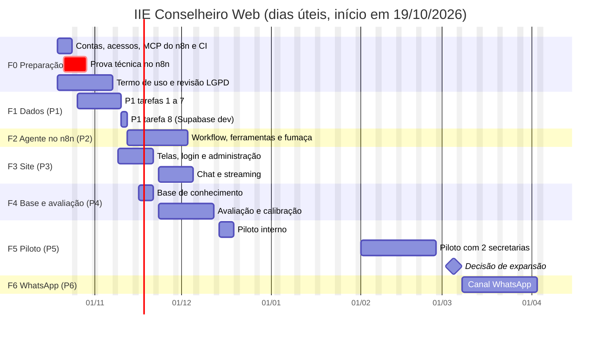

# IIE Conselheiro: plano de desenvolvimento

> **Versão 2.0, 2026-10-13. Nova ordem do projeto: primeiro o site, o WhatsApp por último.**
> Implementa a proposta [`03_proposta_sistema_web.md`](03_proposta_sistema_web.md) (site + agente no n8n). O que continua valendo da proposta [`01_proposta_arquitetura.md`](01_proposta_arquitetura.md): princípios, ferramentas, base de conhecimento, avaliação e LGPD.
> **Horizonte:** início em 19/10/2026; piloto interno em dezembro; piloto com secretarias em fevereiro de 2027; WhatsApp a partir de março de 2027.

## 1. Como o plano está organizado

São **6 subplanos**, numerados na ordem de execução. Cada um entrega algo testável sozinho.

| Subplano | Conteúdo | De onde vem | Situação |
|---|---|---|---|
| [P1: camada de dados](planos/P1_camada_de_dados.md) | Esquemas `iie` e `app` no Supabase, carga, funções SQL, papéis e RLS, mais o catálogo completo de práticas e toda a relação do doc 09 | P1 anterior, **revisada** | Validada localmente. Falta revisar `app` para o site e acrescentar a base de práticas (seção 5) |
| P2: agente no n8n | Workflow `iie-agente-web`: modelo, 7 ferramentas, memória, *streaming*, rastreabilidade, erros | **Substitui** a [P2 em Python](planos/P2_servico_do_agente.md), que fica só como referência | Tarefas e critérios na seção 6. Plano passo a passo a escrever |
| P3: site | Next.js: cadastro, login, administração, chat com várias conversas, *streaming*, conta | **Novo** | Tarefas e critérios na seção 7. Plano passo a passo a escrever |
| P4: base de conhecimento e avaliação | Compilação da base, 85 perguntas, corretores, critérios de liberação | Antiga P3 | Tarefas e critérios na seção 8 |
| P5: piloto web | Piloto interno, piloto com secretarias, rotina de melhoria, monitoramento | Antiga P5 | Tarefas e critérios na seção 9 |
| P6: canal WhatsApp | Meta, workflows de entrada e acesso, vínculo do telefone com o cadastro do site | Antiga P4 | Tarefas e critérios na seção 10 |

**Por que os planos passo a passo vêm na hora:** os planos de P2 e P3 dependem da prova técnica da Fase 0 (seção 4.5). Os de P4 a P6 dependem do que as fases anteriores mostrarem. Cada um é escrito no início da sua fase, no mesmo formato da P1.

**Quem executa:** o Claude gera o código, o SQL e o JSON dos workflows, roda os testes e publica no n8n via MCP. As pessoas da equipe revisam cada PR e aprovam os marcos.

## 2. Fases e marcos

| Fase | Período | Subplano | Marco (critério de saída) |
|---|---|---|---|
| **F0 Preparação e prova técnica** | 19/10 a 30/10 | — | **M0:** prova técnica aprovada nos 6 pontos da [03 §14](03_proposta_sistema_web.md#14-pontos-a-confirmar-na-prova-técnica-fase-0); MCP do n8n funcionando; chave da Anthropic, Supabase de dev e CI prontos |
| **F1 Dados** | 26/10 a 11/11 | P1 | **M1:** testes da P1 passando (os 22 do `iie`, os da base de práticas e os do `app`); catálogo com 541 práticas conferido contra as âncoras; carga no Supabase de dev; primeiro administrador criado; nenhum aviso de RLS |
| **F2 Agente** | 12/11 a 02/12 | P2 | **M2:** roteiro de fumaça passando no n8n de dev; custo da 1ª pergunta e das seguintes medido |
| **F3 Site** | 09/11 a 04/12 | P3 | **M3:** fluxo ponta a ponta (cadastro → aprovação → pergunta → resposta em *streaming*) passando em dev com o agente real |
| **F4 Base e avaliação** | 16/11 a 11/12 | P4 | **M4:** base v1 ativa; avaliação atinge os critérios da [01 §9.2](01_proposta_arquitetura.md#92-avaliação-do-agente); custo médio ≤ US$ 0,15 por pergunta |
| **F5 Piloto** | 14/12 a 18/12 (interno); 01/02 a 05/03/2027 (secretarias) | P5 | **M5:** critérios de sucesso da [03 §15](03_proposta_sistema_web.md#15-critérios-de-sucesso-do-piloto) avaliados e decisão de expansão registrada |
| **F6 WhatsApp** | a partir de 08/03/2027 | P6 | **M6:** cenários ponta a ponta do WhatsApp passando; gestores do piloto usando os dois canais |
| F7 Evolução | depois | — | Prioridades do relatório do piloto ([01 §12](01_proposta_arquitetura.md#12-evolução-depois-do-mvp)) |

**Paralelismo:**
- O site (F3) começa junto com o agente (F2). As telas não dependem do n8n, e o `/api/chat` usa um n8n simulado até a P2 ficar pronta.
- A base de conhecimento (F4) pode ser compilada assim que a P1 estiver no Supabase.

**Por que o piloto com secretarias fica para fevereiro:**
- em dezembro e janeiro há recesso escolar;
- os novos governos estaduais tomam posse em 01/01/2027, o que troca as equipes das secretarias estaduais.

## 3. Equipe

| Papel | Responsabilidades | Dedicação estimada |
|---|---|---|
| Responsável pelo projeto | Decisões (seção 14), aceite dos marcos, relação com as secretarias | 20% |
| Claude (agente de desenvolvimento) | Código (SQL, site, scripts), JSON dos workflows, publicação via MCP, testes, documentação | conforme as fases |
| Desenvolvedor(a) revisor(a), Next.js e dados | Revisão dos PRs, publicação do site, acesso ao Supabase | 50% nas F1–F3, 20% depois |
| Especialista n8n | Revisão dos workflows, credenciais, atualização e operação do n8n | 30% nas F0–F2, 10% depois |
| Especialista em IIE e pedagógico | Curadoria da base, gabarito da avaliação, revisão das recomendações | 30% nas F4–F5 |
| Encarregado(a) de dados (LGPD) | Termo de uso, retenção, termos dos fornecedores | pontual |
| Gestores do piloto | Uso real e avaliação 👍/👎 | F5 |

## 4. Fase 0: preparação e prova técnica

### 4.1 Repositório e CI

- [ ] Commit do material já produzido (`contexto/`, `boas-praticas/`, `projeto/`, `RESUMO_DA_SESSAO.md`), numa *branch* com PR.
- [ ] Proteção da *branch* `main` (PR com revisão).
- [ ] Workflow de CI `.github/workflows/ci.yml` com dois *jobs*:
  - `agente`: Postgres 17 + `pytest`. É o mesmo da versão anterior do plano, ativado quando a P1 criar `agente/`;
  - `web`: `npm ci`, `npm run lint`, `npm test` e `npm run build` em `web/`, ativado quando a P3 criar `web/`.

### 4.2 n8n e MCP

- [ ] Confirmar que o n8n auto-hospedado está na **versão 2.37 ou mais nova**. Se não estiver, atualizar.
- [ ] Criar uma chave de API do n8n para o Claude publicar workflows.
- [ ] **Conectar o MCP do n8n a esta sessão do Claude.** Opções, nesta ordem:
  1. o MCP nativo do n8n, se a versão instalada permitir criar e editar workflows;
  2. o servidor comunitário `n8n-mcp`, com `N8N_API_URL` e `N8N_API_KEY`;
  3. o conector do claude.ai, se ele apontar para este n8n.

  Se nenhum funcionar, a publicação usa a API REST do n8n com a mesma chave.
- [ ] Pasta ou projeto "IIE Conselheiro" no n8n de dev.

### 4.3 Anthropic

- [ ] *Workspaces* `iie-dev` e `iie-prod`. O cache e o relatório de uso ficam separados por *workspace*.
- [ ] Chaves por ambiente e limite de gasto mensal.
- [ ] Termos de retenção e uso de dados registrados para a revisão de LGPD.

### 4.4 Supabase

- [ ] Projeto ou *branch* de desenvolvimento.
- [ ] Esquema `app` exposto na API; `iie` **não** exposto.
- [ ] Auth:
  - confirmação de e-mail ligada;
  - *Site URL* e *Redirect URLs* do site;
  - modelos de e-mail em português.
- [ ] **SMTP próprio**, com domínio verificado (SPF e DKIM). O envio padrão do Supabase tem limite baixo e não serve fora de testes. E-mails de órgãos públicos costumam filtrar remetentes sem verificação.

### 4.5 Prova técnica no n8n (portão do M0)

Montar à mão, ou gerado pelo Claude e publicado via MCP, um workflow mínimo com:
- Webhook com *streaming*;
- AI Agent;
- Anthropic Chat Model versão 1.6, com `claude-opus-5-5` e cache ligado;
- Postgres Chat Memory;
- **uma** ferramenta Postgres com `iie.fn_consultar_iie`. Para isso, carregue antes só a migração e a carga do `iie` num banco de dev, ou use uma consulta fixa equivalente.

Verificar os 6 pontos da [03 §14](03_proposta_sistema_web.md#14-pontos-a-confirmar-na-prova-técnica-fase-0) e registrar os resultados em `projeto/prova_tecnica_n8n.md`. Gasto previsto: menos de US$ 2.

**Se algum ponto falhar, o responsável decide antes da F1:**
- usar uma alternativa (por exemplo, `claude-opus-5` no mesmo nó, ou checagem de rastreabilidade só na avaliação);
- ou voltar ao serviço Python da P2 anterior, que já tem código validado.

### 4.6 LGPD

- [ ] Termo de uso para o site. Conteúdo:
  - finalidade;
  - dados coletados (nome, e-mail, perfil, instituição, UF, município);
  - processamento das perguntas pela Anthropic;
  - retenção de 12 meses;
  - "meus dados" e "excluir minha conta";
  - contato.
- [ ] Revisão do termo pelo(a) encarregado(a).

### 4.7 Decisão da Fase 0

- [ ] **Hospedagem do site:** no mesmo servidor do n8n, via Docker (recomendado: o webhook fica na rede interna), ou na Vercel em plano pago.

## 5. Fase 1: dados (P1 revisada)

As Tarefas 1 a 4 da P1 continuam valendo. O esquema `iie` de dados do IIE, as funções e os 22 testes não mudam. A revisão:
- troca o modelo de `app`;
- acrescenta o que o site precisa;
- leva para o banco o catálogo completo de práticas e toda a relação do doc 09 ([03 §6.1](03_proposta_sistema_web.md#61-esquema-iie)).

| # | Tarefa | Entrega | Critério de aceite |
|---|---|---|---|
| P1.1–P1.4 | Tarefas 1 a 4 da P1 | Projeto `agente/`, esquemas, carga, funções `iie.fn_*`, papéis | Os 22 testes da P1 passam |
| P1.2′ | Tabelas de `app` no modelo da [03 §6.2](03_proposta_sistema_web.md#62-esquema-app-revisado-para-o-site) | Ajuste da Tarefa 2: `usuario` ligado a `auth.users`, `conversa`, `mensagem`, `feedback`, `kb_versao`, `agente_memoria`; sai `solicitacao_acesso`; `vw_uso_diario` revisada | Testes de contagem e estrutura ajustados passam |
| P1.5 | Regras do site (nova) | Gatilho `app.ao_criar_usuario`; `app.eh_admin()`; `app.fn_perguntas_hoje()`; políticas RLS para `authenticated` ([03 §6.3](03_proposta_sistema_web.md#63-acesso)); limpeza da memória ao apagar uma conversa. Nos testes, `auth.uid()` e os papéis `anon` e `authenticated` são simulados | Testes de RLS cobrem: usuário não vê dados de outro; pendente não cria conversa; só administrador muda status; cadastro com município de outra UF é recusado; apagar conversa limpa mensagens e memória |
| P1.6 | Catálogo de práticas (nova) | `contexto/anexos/catalogo_praticas.csv`, com as 541 práticas refeitas a partir de `boas-praticas/`: um agente por documento, em paralelo, seguindo as regras da [03 §6.1](03_proposta_sistema_web.md#61-esquema-iie) ("Catálogo de práticas"). Um script confere as âncoras e os totais | Todas as âncoras (IDs da matriz e do doc 09) nas mesmas linhas; totais 279/93/117/52, ou divergência registrada e decidida pelo especialista; amostra de 10% revisada |
| P1.7 | Relação completa no banco (nova) | `iie.pratica` ampliada (com busca textual), `precondicao`, `precondicao_pratica`, `perfil_territorio`, `perfil_pratica` e `lacuna`; sementes `precondicoes.json`, `perfis.json` e `lacunas.json` extraídas do doc 09 §6–8; carga; `fn_buscar_praticas`, `fn_pacote` e as lacunas na `fn_praticas` | Testes da [03 §8](03_proposta_sistema_web.md#8-qualidade) para a base de práticas passam; o papel `agente_leitura` executa as funções novas e não escreve |
| P1.8 | Aplicar no Supabase de dev | Antiga Tarefa 5. Inclui criar os usuários `agente_app` e `n8n_app` e o primeiro administrador (por SQL) | Mesmas conferências da Tarefa 5; "Advisors → Security" sem avisos de RLS |

## 6. Fase 2: agente no n8n (P2)

Antes de começar, escrever `planos/P2_agente_n8n.md` com os resultados da prova técnica.

| # | Tarefa | Entrega | Critério de aceite |
|---|---|---|---|
| P2.1 | Credenciais no n8n | `anthropic-iie`, `iie-leitura` (`agente_app`), `iie-operacao` (`n8n_app`), `iie-chave-site` (*Header Auth*) | Nenhum segredo em nó nem no JSON versionado |
| P2.2 | Base provisória | `app.kb_versao` com `provisoria-0`, a partir de 02 e 08 de `contexto/`, como na Tarefa 8 da P2 anterior | Registro ativo no banco de dev |
| P2.3 | Ferramentas | 7 nós de ferramenta Postgres: os 5 com as descrições e parâmetros da P2 anterior e os 2 novos da [03 §5.4](03_proposta_sistema_web.md#54-ferramentas), em ordem alfabética e via `$fromAI()` | Cada ferramenta, chamada isoladamente, devolve o mesmo JSON da função SQL |
| P2.4 | Prompt | Mensagem de sistema da [03 §5.3](03_proposta_sistema_web.md#53-prompt), com bytes estáveis, e bloco `<contexto>` na mensagem do usuário | Duas execuções com usuários diferentes produzem a mesma mensagem de sistema (comparação de *hash*) |
| P2.5 | Workflow `iie-agente-web` | JSON em `agente/n8n/iie-agente-web.json`, com os nós 1 a 6 e a saída de erro ([03 §5.2](03_proposta_sistema_web.md#52-workflow-iie-agente-web)). Validado e publicado via MCP | Validação do MCP sem erros; o workflow publicado é igual ao do git |
| P2.6 | Rastreabilidade | Código do nó `rastreabilidade` em `agente/n8n/codigo/rastreabilidade.js`, para números e códigos de prática, testado fora do n8n com `node --test` | Testes com casos positivos e negativos passam; o nó usa o mesmo arquivo |
| P2.7 | Erros | Workflow `iie-erros` e textos fixos de instabilidade e de fora de escopo | Uma chave inválida da Anthropic gera o texto de instabilidade e o registro do erro |
| P2.8 | Roteiro de fumaça | `agente/n8n/fumaca.sh` com as 4 perguntas da P2 anterior (Ceará, evasão, Bahia, fora de escopo), mais uma conversa de 3 perguntas seguidas | Respostas como o esperado na P2 anterior; mensagens gravadas em `app.mensagem`; custo da 1ª pergunta e das seguintes registrado |

## 7. Fase 3: site (P3)

Antes de começar, escrever `planos/P3_site.md`.

| # | Tarefa | Entrega | Critério de aceite |
|---|---|---|---|
| P3.1 | Projeto | `web/` com Next.js (App Router, TypeScript), Tailwind, `@supabase/ssr` e o *middleware* de sessão e redirecionamento | `npm run build` e o CI passam |
| P3.2 | Cadastro e login | `/cadastro` (com `public/municipios.json` do IBGE e aceite do termo), `/entrar`, `/recuperar-senha`, `/nova-senha`, `/auth/confirmar`, `/termo` | Cadastro cria `app.usuario` pendente; confirmação e recuperação de senha funcionam com o SMTP de dev |
| P3.3 | Acesso e administração | `/aguardando` (pendente, recusado, bloqueado) e `/admin` (lista com filtro; aprovar, recusar, bloquear) | Usuário comum não abre `/admin`; aprovar libera o chat no próximo acesso |
| P3.4 | Chat | Barra lateral com as conversas, nova conversa, apagar conversa, conversa vazia com 3 sugestões que usam a UF do usuário, formatação com `react-markdown` | Funciona no celular e por teclado |
| P3.5 | `/api/chat` e *streaming* | As regras da [03 §4](03_proposta_sistema_web.md#post-apichat), o conversor NDJSON → texto e um n8n simulado para desenvolvimento local | Testes unitários do conversor e das regras (401, 403, 429, conversa de outro usuário); o texto aparece aos poucos |
| P3.6 | Avaliação e conta | 👍/👎 com motivo opcional; `/conta` com os dados e "excluir minha conta" (chave de serviço só no servidor) | Excluir a conta apaga usuário, conversas, mensagens e memória (conferido por consulta) |
| P3.7 | Testes e publicação em dev | Teste ponta a ponta com Playwright (cadastro → aprovação → pergunta → resposta) e publicação do site de dev | O teste passa em dev contra o n8n real |

## 8. Fase 4: base de conhecimento e avaliação (P4)

É a antiga P3, com quatro ajustes:
- base de **até 25 mil tokens**;
- o executor chama o **webhook do n8n**, não o serviço Python;
- uma **categoria nova, "Município"**, com 5 perguntas (total de 85);
- custo por rodada ≤ US$ 20.

| # | Tarefa | Entrega | Critério de aceite |
|---|---|---|---|
| P4.1 | Compilador (`agente/kb/build_kb.py`) | Base em ordem fixa a partir de 01, 02, 05 (seções 1, 2, 6 e 7), 06, 08 e 09 (só as seções 1 e 2, sem a tabela de valores; o resto vem das ferramentas) | Nenhuma linha de tabela com sigla de UF; ordem e *hash* estáveis |
| P4.2 | Medir e publicar | Tokens contados com `count_tokens` (`claude-opus-5-5`); `kb/dist/kb_<versao>.md`; registro em `app.kb_versao` | Tamanho entre 15 e 25 mil tokens |
| P4.3 | Perguntas (`agente/evals/perguntas.jsonl`) | 85 itens: as 6 categorias da [01 §9.2](01_proposta_arquitetura.md#92-avaliação-do-agente) mais "Município" (pergunta sobre a cidade → resposta com a UF e o aviso) | Gabarito revisado pelo especialista em IIE |
| P4.4 | Corretores (`agente/evals/corretores.py`) | Um por categoria. Os números são conferidos na trilha de ferramentas gravada em `app.mensagem.ferramentas` | Cada corretor com casos positivos e negativos |
| P4.5 | Executor e relatório (`agente/evals/rodar.py`) | Chama o webhook com perfil, UF e município do item; relatório em JSON e markdown, gravado em `app.kb_versao.avaliacao` | Reprodutível; custo por rodada ≤ US$ 20 |
| P4.6 | Calibração e ativação | Ajustes de prompt e base até atingir os critérios; decisões de TTL, *proxy* de cache e modelo (seção 14) | Critérios atingidos; versão ativada; `agente/CHANGELOG.md` atualizado |

## 9. Fase 5: piloto web (P5)

| # | Tarefa | Entrega | Critério de aceite |
|---|---|---|---|
| P5.1 | Piloto interno (14/12 a 18/12) | 10 pessoas da equipe, 100 perguntas ou mais, triagem diária dos 👎 e dos números sem origem | Nenhum erro numérico aberto; custo médio medido |
| P5.2 | Seleção das secretarias (até 15/01/2027) | 2 secretarias com perfis diferentes no doc 09, com ≥ 15 gestores cada. Preferir **secretarias municipais** ou estaduais com equipe já confirmada para 2027 | Termo de adesão assinado |
| P5.3 | Integração dos gestores | Cadastro pelo site, aprovação em lote no `/admin`, sessão de 30 minutos e guia de uma página | ≥ 30 usuários ativos na primeira semana |
| P5.4 | Monitoramento | Workflow `iie-monitoramento` (diário, 8h): cadastros pendentes, erros, latência, 👎 e números sem origem. Custo: relatório de uso da Anthropic, pela Admin API se houver chave de administrador, ou conferência semanal no Console | Resumo chega todo dia à equipe |
| P5.5 | Rotina semanal | Reunião de 1 h: métricas, 👎, perguntas sem dado, custo. Mudança no agente sempre com nova rodada da avaliação | Ata e `CHANGELOG` por semana |
| P5.6 | Encerramento (05/03/2027) | Relatório frente à [03 §15](03_proposta_sistema_web.md#15-critérios-de-sucesso-do-piloto) e *backlog* priorizado | Decisão de expansão registrada |

## 10. Fase 6: canal WhatsApp (P6)

A conta da Meta demora para ser aprovada. Por isso a preparação (verificação do Business Manager, número dedicado, *templates*) começa **durante a F5**, em paralelo.

| # | Tarefa | Entrega | Critério de aceite |
|---|---|---|---|
| P6.1 | Vínculo do telefone | Em `/conta`, o usuário informa o celular e confirma com um código enviado pelo WhatsApp. O resultado fica em `app.usuario.telefone_e164` | Só usuários ativos do site conseguem usar o WhatsApp |
| P6.2 | Agente compartilhado | O WhatsApp reaproveita o agente: chama o mesmo workflow (sem *streaming*) ou um sub-workflow extraído dele. A escolha é feita no plano da P6 | As mesmas respostas da avaliação nos dois canais |
| P6.3 | Workflows de canal | WF-01 (entrada), WF-02 (acesso pelo telefone vinculado), WF-03 (conversa, com agrupamento de mensagens), WF-07 (feedback) e WF-08 (LGPD), da [01 §5](01_proposta_arquitetura.md#5-workflows-no-n8n), adaptados. O WF-04 deixa de existir, porque o cadastro é no site | Os cenários ponta a ponta da versão anterior do plano passam, menos o 1 e o 2, que viram "telefone não vinculado" |
| P6.4 | Formato WhatsApp | Pós-processamento para WhatsApp (negrito com `*`, sem tabelas, partes de até 1.500 caracteres) e canal informado no `<contexto>` | Nenhuma tabela ou título chega ao WhatsApp |

## 11. Definição de pronto

Uma tarefa só está pronta quando cumpre todos os itens:

1. Os testes automatizados do subplano passam localmente e no CI.
2. Houve revisão de código por uma pessoa da equipe no PR.
3. **Workflows do n8n:** o JSON publicado é o mesmo do git, e passou pela validação do MCP e pelo roteiro de fumaça.
4. **Mudanças em prompt, base de conhecimento, ferramentas ou modelo** passaram por uma rodada da avaliação que atingiu os critérios. Isso vale a partir da F4.
5. A documentação em `projeto/` e `contexto/` foi atualizada quando o comportamento mudou.
6. Não há segredos no git. As variáveis novas estão documentadas na [03 §12](03_proposta_sistema_web.md#12-implantação).

## 12. Controle de mudanças do agente

| O que muda | Onde fica a versão | Como libera |
|---|---|---|
| Prompt, ferramentas, modelo, cache | `agente/n8n/iie-agente-web.json` (git) | PR + avaliação + publicação via MCP |
| Base de conhecimento | `app.kb_versao` | Compilação + avaliação + `ativa = true` (sem reinício) |
| Dados do IIE | `iie.*` + `iie.carga` | Script de carga da P1 + testes da P1 no CI |
| Site | `web/` (git) | PR + CI + publicação |

Toda liberação do agente é registrada em `agente/CHANGELOG.md`, com a versão da base, o resultado da avaliação e o custo medido.

## 13. Orçamento até o fim do piloto (estimativa)

| Item | Estimativa |
|---|---:|
| Claude: prova técnica, desenvolvimento e fumaça | ≈ US$ 30 |
| Claude: avaliações (85 perguntas × ≈ US$ 0,20 com o corretor, ≈ 10 rodadas) | ≈ US$ 170 |
| Claude: piloto (500 a 1.000 perguntas × US$ 0,10 a 0,17) | ≈ US$ 50 a 170 |
| Hospedagem do site (5 meses) | US$ 0 a 100 |
| SMTP transacional | baixo ou nulo no volume do piloto |
| n8n e Supabase | infraestrutura já existente |
| **Total incremental estimado** | **≈ US$ 250 a 470** |

## 14. Decisões programadas

| Decisão | Quando | Quem decide | Com base em |
|---|---|---|---|
| Hospedagem do site | F0 | Responsável + dev | Onde o n8n roda |
| Seguir com o agente no n8n (ou voltar ao serviço Python) | Fim da F0 | Responsável pelo projeto | Prova técnica |
| TTL do cache (5 min ou 1 h) | F2 | Responsável + Claude | Intervalo medido entre perguntas |
| *Proxy* com ponto de cache explícito | F4 | Responsável pelo projeto | Custo médio medido acima de US$ 0,15 |
| Modelo (`claude-opus-5-5` ou `claude-sonnet-5-5`) | Fim da F4 | Responsável pelo projeto | Avaliação comparativa; só trocar se os critérios continuarem atendidos |
| Limite diário por usuário (padrão 40) | F4 | Responsável pelo projeto | Custo por pergunta |
| Secretarias do piloto | Até 15/01/2027 | Responsável + Instituto Natura | Critérios da P5.2 |
| Expansão e início do WhatsApp | Fim da F5 | Responsável + Instituto Natura | Relatório do piloto |

## 15. Riscos do cronograma

| Risco | Efeito no plano | Mitigação |
|---|---|---|
| Prova técnica falhar em algum ponto | Adia a F2 | A F1 não depende dela; o serviço Python da P2 anterior é o plano B, já validado |
| n8n abaixo da 2.37 ou atualização bloqueada | Sem cache: custo ≈ 2,4 vezes maior | Atualizar na F0; se não der, *proxy* com cache (03 §11) |
| MCP do n8n indisponível | Publicação manual | API REST do n8n com o mesmo JSON |
| E-mails de confirmação barrados nos órgãos públicos | Cadastros travados | SMTP próprio com SPF e DKIM; o administrador pode confirmar o e-mail manualmente |
| Recesso e troca de governos em janeiro | Piloto com secretarias adiado | Piloto interno em dezembro; secretarias em fevereiro, de preferência municipais |
| Avaliação não atingir os critérios | Adia o M4 | Folga de 5 dias na P4.6; alavancas: base, exemplos no prompt e modelo |
| Revisão de LGPD atrasar | Bloqueia o piloto com secretarias | Começar o termo na F0; o piloto interno não depende dele |
