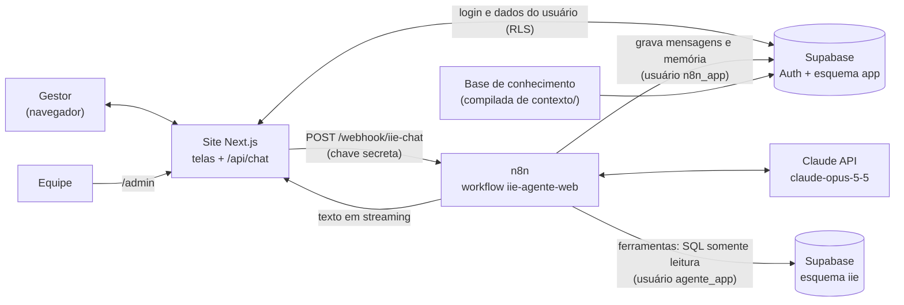

# IIE Conselheiro Web: proposta de arquitetura

> Versão 0.1, 2026-10-13. **Rascunho para revisão.**
> Esta proposta muda a ordem do projeto: o **sistema web** vem primeiro e o WhatsApp fica para a última fase. Ela substitui as seções 3, 5, 6, 8.2, 13 e 14 de [`01_proposta_arquitetura.md`](01_proposta_arquitetura.md). O resto da 01 continua valendo: princípios, ferramentas, base de conhecimento, avaliação e LGPD.
> O plano de execução está em [`02_plano_desenvolvimento.md`](02_plano_desenvolvimento.md).

## 1. Objetivo

Um site onde gestores da educação se cadastram, informam estado e município e, depois de aprovados pela equipe, conversam com o IIE Conselheiro numa interface semelhante à do Claude ou do ChatGPT. Eles podem abrir várias conversas sobre os dados do IIE da sua região e receber orientação de práticas de gestão.

### O que muda em relação à proposta 01

| Tema | Proposta 01 | Agora |
|---|---|---|
| Canal inicial | WhatsApp | **Site (Next.js)**. O WhatsApp passa para a última fase |
| Onde o agente roda | Serviço Python (FastAPI + SDK da Anthropic) | **n8n auto-hospedado**: nó AI Agent + nó Anthropic Chat Model |
| Cadastro | Equipe cadastra o telefone | **Cadastro livre no site**, com aprovação da equipe numa tela de administração |
| Login | Número de telefone | **E-mail e senha** (Supabase Auth) |
| Modelo | `claude-opus-5` | **`claude-opus-5-5`** (Opus 5.5): mais novo e 20% mais barato |
| Plano P2 (serviço Python) | Validado localmente | **Substituído** pelo agente no n8n. O código fica só como referência |

**Continua igual:**
- Números só vêm das funções SQL `iie.fn_*`. O modelo interpreta e explica, mas nunca é a fonte de um número.
- A camada de dados da P1: esquema `iie`, carga e funções.
- As 5 ferramentas da 01, agora com mais 2 (seção 5.4), a base de conhecimento e a avaliação: as 80 perguntas da 01, mais 5 sobre município.

**Princípio novo:** as **práticas** seguem a mesma regra dos números. Todo código de prática citado (GE-, GE-SEC-, SM-, PE-) vem de uma ferramenta chamada na conversa. O catálogo completo e toda a relação entre indicadores e práticas ficam no Supabase (seção 6.1).

### Decisões

| # | Decisão | Escolha |
|---|---|---|
| W1 | Canal inicial | Site em **Next.js** |
| W2 | Acesso | **Cadastro livre**. O chat só fica disponível depois que a equipe aprova o cadastro |
| W3 | Login | **E-mail e senha** no Supabase Auth, com confirmação de e-mail e recuperação de senha |
| W4 | Região | O cadastro pede **UF e município**. Hoje o agente responde com os dados da **UF** e informa que o dado municipal ainda não está disponível. O município fica guardado para quando houver dados |
| W5 | Outras regiões | A UF do cadastro é o padrão. O usuário **pode perguntar sobre outras UFs** e pedir comparações |
| W6 | Agente | **n8n auto-hospedado, versão 2.37 ou mais nova** (que traz o cache do nó Anthropic) |
| W7 | Modelo | `claude-opus-5-5`, com raciocínio adaptativo e esforço `medium`, que são os padrões do modelo |
| W8 | Workflows | O JSON dos workflows é **gerado pelo Claude**, versionado no git e publicado no n8n **via MCP** |
| W9 | Banco | O **Supabase** já em uso, com projeto ou *branch* de desenvolvimento separado |
| W10 | Base de práticas | **No Supabase:** o catálogo completo das **541 práticas** dos três referenciais e toda a relação do doc 09 (vínculos com indicadores, pré-condições, pacotes por perfil de território e lacunas) |

### Fora do escopo do MVP web

- WhatsApp: fase final.
- Dados municipais: entram quando a base existir.
- Envio de arquivos, voz e gráficos.
- E-mail avisando que o cadastro foi aprovado. A pessoa descobre ao entrar de novo.
- Login social (Google).
- Editar ou regenerar mensagens; compartilhar ou buscar conversas.
- Editar o próprio cadastro. Se houver erro, a equipe corrige.

## 2. Requisitos

### Funcionais

| ID | Requisito |
|---|---|
| RW01 | **Cadastro** com nome, e-mail, senha, perfil, instituição, UF, município e aceite do termo de uso. A lista de municípios é filtrada pela UF escolhida |
| RW02 | Confirmação de e-mail, login, "esqueci minha senha" e sair |
| RW03 | Depois do login, o que aparece depende do status: **pendente** vê a tela "cadastro em análise"; **recusado** e **bloqueado** veem um aviso; **ativo** vê o chat |
| RW04 | **Administração** (só equipe): lista de cadastros, com filtro de pendentes, e ações de aprovar, recusar e bloquear |
| RW05 | **Chat:** barra lateral com as conversas, das mais recentes para as mais antigas; "nova conversa"; apagar conversa. O título é o começo da primeira pergunta |
| RW06 | A resposta aparece aos poucos (*streaming*) e com formatação (negrito, listas e tabelas pequenas) |
| RW07 | Uma conversa nova mostra 3 sugestões de pergunta já com a UF do usuário. Ex.: "Como está o Ceará no IIE?", "Onde o Ceará deveria agir primeiro?", "O que é o IIE?" |
| RW08 | Avaliação 👍/👎 em cada resposta, com motivo opcional no 👎 |
| RW09 | Limite diário por usuário, padrão de 40 perguntas, com aviso de quando o limite renova |
| RW10 | **Meus dados:** página com os dados do cadastro e o botão "excluir minha conta", que apaga conversas, mensagens, memória do agente e a conta |
| RW11 | Cada resposta registra ferramentas usadas, latência, números e práticas sem origem, modelo e versão da base de conhecimento |

### Não funcionais

Valem os da proposta 01 (seção 2), com estes ajustes:

| ID | Requisito | Meta |
|---|---|---|
| RNF02 | Latência até o **primeiro trecho** da resposta | mediana ≤ 8 s; resposta completa: mediana ≤ 20 s |
| RNF04 | Custo | ≤ US$ 0,15 por pergunta, **na média do mês** (ver seção 11) |
| RNF08 | Navegadores | Chrome, Edge, Safari e Firefox atuais; layout utilizável no celular |
| RNF09 | Acessibilidade | navegação por teclado, contraste AA e rótulos nos campos |

## 3. Visão geral



**Divisão de responsabilidades**
- **Site:** telas, sessão e regras de acesso (status ativo, limite diário, dono da conversa). Cria as conversas, repassa a pergunta ao n8n e transmite a resposta ao navegador. **Não chama o Claude.**
- **n8n:** é o agente. Monta o contexto, chama o Claude com as ferramentas SQL, grava a pergunta e a resposta e faz a checagem de rastreabilidade. **Não decide quem pode usar:** confia no site, que se identifica com a chave secreta.
- **Supabase:** login, dados do IIE, usuários, conversas, mensagens e versões da base de conhecimento.
- **Claude:** interpreta e explica. Nunca é a fonte de um número.

### Fluxo de uma pergunta

```mermaid
sequenceDiagram
  participant N as Navegador
  participant S as Site (/api/chat)
  participant DB as Supabase
  participant F as n8n
  participant C as Claude
  N->>S: pergunta + conversa_id (ou nova)
  S->>DB: sessão válida? status ativo? limite do dia? conversa é do usuário?
  S->>DB: cria a conversa, se for nova
  S->>F: POST /webhook/iie-chat (chave, usuário, UF, perfil, pergunta)
  F->>DB: grava a mensagem do usuário; lê a base ativa e a memória da conversa
  F->>C: system (regras + base) · histórico · contexto + pergunta
  C-->>F: chama ferramentas
  F->>DB: iie.fn_* (somente leitura)
  F->>C: resultados das ferramentas
  C-->>F: resposta em streaming
  F-->>S: trechos (NDJSON)
  S-->>N: trechos de texto
  F->>DB: grava a resposta (ferramentas, latência, números sem origem)
  N->>S: recarrega a conversa (pega o id da resposta para o 👍/👎)
```

## 4. Site (Next.js)

**Stack:**
- Next.js com App Router e TypeScript;
- `@supabase/ssr` (sessão em *cookies*);
- Tailwind CSS;
- `react-markdown` com `remark-gfm` para formatar as respostas.

Nenhuma outra biblioteca de interface no MVP.

### Telas e rotas

| Rota | Quem acessa | Conteúdo |
|---|---|---|
| `/cadastro` | público | Formulário do RW01. Os municípios vêm de um JSON estático do IBGE, filtrado pela UF |
| `/entrar`, `/recuperar-senha`, `/nova-senha` | público | Login e recuperação de senha |
| `/auth/confirmar` | público | Retorno do link de confirmação de e-mail |
| `/termo` | público | Termo de uso |
| `/aguardando` | logado, status ≠ ativo | "Cadastro em análise", "Cadastro recusado" ou "Acesso bloqueado" |
| `/` | ativo | Barra lateral com as conversas e uma conversa vazia com sugestões (RW07) |
| `/c/[id]` | ativo e dono da conversa | Conversa: mensagens, campo de pergunta, 👍/👎 |
| `/conta` | logado | Meus dados e excluir conta (RW10) |
| `/admin` | `papel = admin` | Cadastros: aprovar, recusar, bloquear (RW04) |
| `POST /api/chat` | ativo | Valida, cria a conversa, chama o n8n e transmite a resposta |

O *middleware* do Next.js renova a sessão e redireciona:
- quem não está logado → `/entrar`;
- status diferente de ativo → `/aguardando`;
- quem não é administrador e tenta abrir `/admin` → `/`.

### `POST /api/chat`

1. Lê a sessão no servidor. Sem sessão, devolve 401.
2. Confere `app.usuario.status = 'ativo'`. Se não, devolve 403.
3. Confere o limite diário com `app.fn_perguntas_hoje()`. Atingido, devolve 429 com o horário de renovação.
4. Se veio `conversa_id`, confere se a conversa é do usuário (a RLS já garante). Se não veio, cria a conversa com `titulo` = primeiros 60 caracteres da pergunta.
5. Chama o webhook do n8n com o contrato da seção 5.1, com tempo limite de 120 s.
6. Converte o NDJSON do n8n num *stream* de texto simples para o navegador. Em erro do n8n, envia a mensagem fixa de instabilidade.

## 5. Agente no n8n

### 5.1 Contrato site → n8n

`POST {N8N_URL}/webhook/iie-chat`, com o cabeçalho `X-IIE-Chave`, conferido pela credencial *Header Auth* do nó Webhook.

```json
{
  "usuario_id": "6f1c…",
  "conversa_id": "a93e…",
  "mensagem": "Como está o Ceará?",
  "perfil": "secretaria_estadual",
  "uf": "CE",
  "municipio": "Sobral",
  "data_referencia": "2026-10-13"
}
```

**Resposta:** *stream* NDJSON no formato do n8n, com eventos `begin`, `item` (trecho de texto) e `end`.

A mensagem final, com metadados, fica gravada em `app.mensagem`. O site não depende de metadados no *stream*.

### 5.2 Workflow `iie-agente-web`

| # | Nó | Configuração |
|---|---|---|
| 1 | **Webhook** | `POST /iie-chat`; autenticação *Header Auth*; *Response Mode* = Streaming |
| 2 | **Postgres** `grava-pergunta` | `insert into app.mensagem (conversa_id, papel, texto) values (…, 'usuario', …)`. Credencial `iie-operacao` |
| 3 | **Postgres** `base-ativa` | `select versao, conteudo from app.kb_versao where ativa` |
| 4 | **AI Agent** (Tools Agent) | *System Message* = regras (seção 5.3) + `{{ conteudo }}` da base ativa; *Prompt* = bloco de contexto + pergunta; *Max Iterations* = 6; *Enable Streaming* ligado; *Return Intermediate Steps* ligado |
| 4a | ↳ **Anthropic Chat Model** (versão 1.6) | Modelo `claude-opus-5-5`; *Maximum Number of Tokens* = 16000; **Enable Prompt Caching** ligado; **Cache TTL** = 5 minutos (seção 11); raciocínio sem configuração, para que o modelo use o adaptativo padrão |
| 4b | ↳ **Postgres Chat Memory** | Tabela `app.agente_memoria`; chave da sessão = `conversa_id`; janela de 20 mensagens |
| 4c | ↳ **7 ferramentas Postgres** | Uma por função `iie.fn_*` (seção 5.4). Credencial `iie-leitura`, somente leitura |
| 5 | **Code** `rastreabilidade` | Extrai os números e os códigos de prática da resposta e confere se cada um aparece nas saídas das ferramentas (passos intermediários) ou na lista de constantes. Monta `ferramentas`, `numeros_sem_origem` e `praticas_sem_origem`. Resposta vazia (recusa) vira o texto fixo de fora de escopo |
| 6 | **Postgres** `grava-resposta` | `insert into app.mensagem (… 'agente', texto, ferramentas, numeros_sem_origem, latencia_ms, modelo, kb_versao)` |
| E | **Saída de erro** do AI Agent | Grava `app.mensagem` com `erro` e responde com o texto fixo de instabilidade |

O *Settings* do workflow aponta para o workflow de erros (`iie-erros`), que registra as falhas não tratadas.

Fontes sobre o cache do nó: [PR #34482](https://github.com/n8n-io/n8n/pull/34482), que traz as opções "Enable Prompt Caching" e "Cache TTL" no nó versão 1.6, publicado no n8n 2.37.0; e o [tópico da comunidade](https://community.n8n.io/t/anthropic-chat-model-node-add-cache-control-prompt-caching-support-got-created/294797).

### 5.3 Prompt

- **Mensagem de sistema:** é o esqueleto da proposta 01 (seção 7.1), com três ajustes:
  - **Formato web:** markdown, com negrito, listas e no máximo uma tabela pequena; até cerca de 2.500 caracteres por resposta.
  - **Município:** "o usuário informa o município; os dados do IIE existem só por UF. Responda com a UF e diga, uma vez por conversa, que o dado municipal ainda não está disponível".
  - **Contexto:** "o bloco `<contexto>` no começo da mensagem do usuário traz perfil, UF, município e data. Use a UF como padrão quando a pergunta não disser o território".
- **Bytes estáveis:** a mensagem de sistema não muda entre usuários nem entre pedidos. Não pode conter data, nome ou UF.
- **Mensagem do usuário:**

```
<contexto>perfil: secretaria_estadual · UF: CE · município: Sobral · data: 2026-10-13</contexto>

Como está o Ceará?
```

O contexto fica na mensagem do usuário porque o nó do n8n não oferece o canal `role: "system"` no meio da conversa. O contexto não dá nenhum privilégio: são só preferências de UF e perfil, então forjá-lo não abre acesso a nada.

### 5.4 Ferramentas

São as 5 da proposta 01 (seção 6.3) e mais 2 que usam a base de práticas. Cada uma vira um nó de ferramenta Postgres, com os parâmetros preenchidos pelo modelo via `$fromAI()`. Exemplo de consulta:

```sql
select iie.fn_ranking($1, $2::int, nullif($3, 'todas'), $4::int)
```

| Ferramenta | Parâmetros | Devolve | Função SQL |
|---|---|---|---|
| `buscar_praticas` (nova) | `termo`; `fonte` ∈ {todas, MEC, Itaú Social, TPE}; `nivel` ∈ {todos, Escola, Secretaria, Estrategico} | Até 10 práticas do catálogo mais parecidas com o termo, por busca textual em português sem acento. Para cada uma: id, nome, descrição, fonte, seção do documento, linhas e indicadores a que está vinculada | `iie.fn_buscar_praticas` |
| `comparar_territorios` | igual à 01 | igual à 01 | `iie.fn_comparar` |
| `consultar_iie` | igual à 01 | igual à 01 | `iie.fn_consultar_iie` |
| `decompor_iie` | igual à 01 | igual à 01 | `iie.fn_decompor` |
| `pacote_por_perfil` (nova) | `perfil` ∈ {fluxo, aprendizagem, duplo, evasao, perda_em, dado} | Nome e critério do perfil, sequência de indicadores recomendada, práticas do pacote e as pré-condições da base comum com suas práticas | `iie.fn_pacote` |
| `praticas_para_indicador` | igual à 01 | igual à 01, mais as **lacunas** dos referenciais para aquele indicador e o complemento sugerido | `iie.fn_praticas` |
| `ranking` | igual à 01 | igual à 01 | `iie.fn_ranking` |

- **Descrições e parâmetros:** os das 5 ferramentas antigas são idênticos aos da P2 (`ferramentas.py`). As 7 ficam em ordem alfabética.
- **Escolha do perfil:** o agente escolhe o perfil a partir da ordem de prioridade e do semáforo de `decompor_iie`. A classificação automática fica fora do MVP, porque a tipologia do doc 09 não segue uma regra única: o RS aparece como "gargalo de fluxo" com A1 🟡, e o RN aparece como "gargalo duplo" numa situação parecida. O especialista em IIE precisa definir o critério antes.
- **Erros:** erro no SQL, como território não encontrado, volta para o agente como resultado de erro. O agente pede esclarecimento.
- **Somente leitura:** a credencial `iie-leitura` usa o usuário `agente_app` (papel `agente_leitura` da P1). Mesmo que alguém manipule o prompt, as ferramentas só leem.

### 5.5 Recursos do Claude que o n8n não oferece

| Recurso (proposta 01) | No n8n | Tratamento |
|---|---|---|
| *Fallback* automático de recusa (`fallbacks: "default"`) | não exposto | Recusa vira o texto fixo de fora de escopo (nó 5). Acompanhar a taxa de recusas |
| Esforço explícito | não exposto | O padrão do Opus 5.5 já é `medium`, o valor planejado |
| Ponto de cache explícito no fim do `system` | não: o cache do nó é automático, no fim do pedido | Custo maior na primeira pergunta de cada conversa (seção 11). Alavancas na seção 11 |
| Uso de tokens separado (leitura e escrita de cache) | o nó soma tudo em `promptTokens` | Custo medido pelo relatório de uso do *workspace* da Anthropic, separado para o projeto |

## 6. Dados (Supabase)

### 6.1 Esquema `iie`

Igual ao da P1 (territórios, resultados, componentes, indicadores, alertas e funções), com a base de práticas completa:

| Tabela | Campos principais | Origem |
|---|---|---|
| `pratica` (ampliada) | `id` (GE-1 a GE-279, GE-SEC-1 a 93, SM-1 a 117, PE-1 a 52), `fonte`, `documento`, `nivel` (Escola, Secretaria, Estratégico), `secao` (dimensão e subdimensão no MEC, eixo no Itaú Social, etapa no TPE), `nome`, `descricao`, `linhas`, `alavancas[]` (acesso, fluxo, aprendizagem, equidade, dados, estruturantes), coluna de busca textual gerada | `contexto/anexos/catalogo_praticas.csv`, com **541 linhas** (ver "Catálogo de práticas" abaixo) |
| `indicador_pratica` | igual à P1: 133 vínculos | `matriz_indicador_pratica.csv` |
| `precondicao` (nova) | `id` (lideranca, acompanhamento, planejamento, monitoramento, recursos, coerencia), `nome`, `o_que_garantir`, `ordem` | doc 09 §6 e as 6 linhas `BASE` da matriz |
| `precondicao_pratica` (nova) | `precondicao_id`, `pratica_id`, `ordem` | doc 09 §6 |
| `perfil_territorio` (nova) | `id` (fluxo, aprendizagem, duplo, evasao, perda_em, dado), `nome`, `criterio`, `sequencia[]`, `descricao` | doc 09 §7 |
| `perfil_pratica` (nova) | `perfil_id`, `pratica_id`, `ordem` | doc 09 §7 |
| `lacuna` (nova) | `id`, `tema`, `cobertura`, `complemento`, `indicadores[]` | doc 09 §8 |

**Funções novas:** `fn_buscar_praticas` e `fn_pacote`. A `fn_praticas` passa a devolver também as lacunas do indicador.

**Ficam fora do banco:** os exemplos aplicados do doc 09 (AM, RJ, CE, MT). Eles trazem números por território, que só podem vir das ferramentas de dados.

#### Catálogo de práticas

O inventário das 541 práticas feito em 2026-09-11 não foi salvo: só as cerca de 128 práticas citadas no doc 09 ficaram registradas. Por isso, a P1 refaz o catálogo a partir de `boas-praticas/`:

1. Numeração na ordem de aparição em cada documento, como no inventário original. Uma prática é cada ação ou recomendação distinta, com sua referência de linha.
2. **Âncoras:** os IDs já usados na matriz e no doc 09 precisam cair nas mesmas linhas. Isso confere a granularidade da contagem. Os totais esperados são 279 (GE), 93 (GE-SEC), 117 (SM) e 52 (PE).
3. Se houver divergência, os IDs da matriz prevalecem. As diferenças de total ficam registradas e são decididas pelo especialista em IIE.
4. `nome` e `descricao` são paráfrases fiéis, não cópias. A `secao` segue a estrutura de cada documento. As `alavancas` refazem a classificação preliminar da sessão de 2026-09-11.
5. O especialista em IIE revisa uma amostra de 10%.

### 6.2 Esquema `app` (revisado para o site)

| Tabela | Campos principais | Quem grava |
|---|---|---|
| `usuario` | `id` (= `auth.users.id`), `email` (cópia do Auth, para a tela de administração), `nome`, `perfil` (escola, secretaria_municipal, secretaria_estadual, equipe_interna, outro), `instituicao`, `uf` (sigla), `municipio_ibge` (7 dígitos), `municipio_nome`, `status` (pendente, ativo, recusado, bloqueado), `papel` (usuario, admin), `aceite_termo_em`, `decidido_por`, `decidido_em`, `criado_em`, `telefone_e164` (nulo até a fase WhatsApp) | gatilho de cadastro; administrador (status e papel) |
| `conversa` | `id`, `usuario_id`, `titulo`, `canal` (web), `criada_em`, `atualizada_em` | usuário (via RLS) |
| `mensagem` | `id`, `conversa_id`, `papel` (usuario, agente), `texto`, `ferramentas` jsonb, `numeros_sem_origem` jsonb, `praticas_sem_origem` jsonb, `latencia_ms`, `modelo`, `kb_versao`, `erro`, `criado_em` | n8n |
| `feedback` | `mensagem_id`, `usuario_id`, `nota` (+1 ou −1), `motivo`, `criado_em` | usuário (via RLS) |
| `cota_diaria` | `usuario_id`, `dia`, `perguntas` | gatilho de mensagem nova. Fica separada de `mensagem` para que apagar conversas não zere o limite diário |
| `kb_versao` | igual à P1 | equipe (compilação) |
| `agente_memoria` | `id`, `session_id`, `message` jsonb: o formato do *Postgres Chat Memory* do n8n | n8n |

**Funções e gatilhos:**
- **`app.ao_criar_usuario()`:** gatilho em `auth.users`, `security definer`. Cria `app.usuario` com status `pendente` a partir dos metadados do cadastro. Valida a UF e se o município pertence a ela: os 2 primeiros dígitos do código IBGE são o código da UF.
- **`app.eh_admin()`:** `security definer`, usada nas políticas.
- **`app.fn_perguntas_hoje()`:** perguntas do usuário no dia, no fuso de Brasília, lidas de `app.cota_diaria`.
- **Exclusão de conversa:** um gatilho apaga as linhas de `app.agente_memoria` com `session_id` igual à conversa. As mensagens saem por `on delete cascade`.
- **`app.vw_uso_diario`:** mensagens, latência p50/p95, taxa de 👎, erros, números sem origem e cadastros pendentes.

### 6.3 Acesso

- O esquema `app` passa a ser **exposto na API** do Supabase, porque o site o lê com a sessão do usuário, sempre protegido por RLS. O `iie` continua **não exposto**.
- **Políticas RLS no papel `authenticated`:**

| Tabela | Ler | Criar | Mudar | Apagar |
|---|---|---|---|---|
| `usuario` | o próprio; admin vê todos | — (gatilho) | só admin | — (exclusão de conta pelo servidor) |
| `conversa` | as próprias | se o status for ativo | o título das próprias | as próprias |
| `mensagem` | as das próprias conversas | — | — | — |
| `feedback` | o próprio | nas mensagens das próprias conversas | — | — |
| `kb_versao`, `agente_memoria`, `cota_diaria` | — | — | — | — |

- **Credenciais do n8n:**
  - `iie-leitura`: usuário `agente_app`, papel `agente_leitura`; usada só pelas ferramentas;
  - `iie-operacao`: usuário `n8n_app`, papel `n8n_operacao`; grava `app.mensagem` e `app.agente_memoria` e lê `app.kb_versao`.
- **Chave de serviço do Supabase:** só no servidor do site, usada apenas para excluir a conta (`auth.admin.deleteUser`).

## 7. Base de conhecimento

Igual à proposta 01 (seção 7) e à P3 do plano anterior:
- compilação a partir de `contexto/`;
- números por território ficam fora da base;
- registro em `app.kb_versao`.

Três mudanças:
1. A base é lida pelo nó 3 do workflow a cada pergunta. Trocar a versão ativa **não exige reiniciar nada**.
2. O tamanho afeta o custo da primeira pergunta de cada conversa (seção 11). A meta passa a ser **até 25 mil tokens**, contra 25 a 40 mil antes.
3. **Do doc 09 entram só as seções 1 e 2** (como usar e a árvore de indicadores, sem a tabela de valores). Práticas, pacotes, pré-condições e lacunas vêm das ferramentas. Isso ajuda a cumprir a meta de tamanho.

## 8. Qualidade

| Camada | Teste | Onde roda |
|---|---|---|
| SQL (`iie`) | os 22 testes da P1 (pytest + Postgres 17), mais os da base de práticas: 541 práticas com os totais por fonte; âncoras da matriz nas mesmas linhas; todo vínculo, pré-condição e pacote aponta para uma prática do catálogo; `fn_buscar_praticas('busca ativa')` traz SM-79; `fn_pacote('evasao')` traz SM-79 e as 6 pré-condições | local e CI |
| SQL (`app`) | RLS, gatilho de cadastro, limite diário, exclusão em cascata. Usa os papéis `anon` e `authenticated` e uma função `auth.uid()` simulada | local e CI |
| Workflow n8n | validação do JSON pela ferramenta do MCP antes de publicar; roteiro de fumaça com 4 perguntas (as da P2, Tarefa 8) via `curl` no webhook | dev |
| Site | testes unitários do conversor NDJSON → texto e das regras do `/api/chat`; 1 teste ponta a ponta (Playwright): cadastro → aprovação → pergunta → resposta | local, CI e dev |
| Agente | avaliação com 85 perguntas (as 80 da proposta 01, mais 5 sobre município) e os critérios da proposta 01 (seção 9.2), chamando o webhook | dev, antes de cada liberação |

## 9. Tratamento de erros

| Situação | Comportamento |
|---|---|
| Sessão expirada | O *middleware* renova; se não der, manda para `/entrar` |
| Usuário não ativo chama `/api/chat` | 403. A tela leva para `/aguardando` |
| Limite diário atingido | 429 com o horário de renovação. O campo de pergunta mostra o aviso |
| n8n fora do ar ou demora mais de 120 s | Mensagem fixa: "estou com instabilidade, tente de novo em alguns minutos". O botão "tentar de novo" reenvia a pergunta |
| Claude com 429, 5xx ou recusa | Saída de erro do AI Agent: grava o erro e responde com o texto fixo correspondente |
| Ferramenta com erro ou território não encontrado | O erro volta para o agente, que pede esclarecimento |
| Dado inexistente (município, escola) | O agente informa que o dado não está disponível e oferece a UF |
| Conexão do navegador cai no meio do *stream* | A resposta continua sendo gravada pelo n8n. Ao recarregar, a conversa mostra a resposta completa |

## 10. Segurança e LGPD

- **Senhas:** ficam só no Supabase Auth, com confirmação de e-mail e a proteção do próprio Auth contra abuso de cadastro e login.
- **Dados:** RLS em todas as tabelas de `app`. O `iie` não é exposto.
- **Ferramentas do agente:** usam uma credencial somente leitura.
- **Chave secreta site → n8n:** fica no servidor do site e na credencial do n8n, nunca no navegador. Se o site e o n8n estiverem no mesmo servidor, o webhook fica só na rede interna.
- **Termo de uso:** aceite obrigatório no cadastro (`aceite_termo_em`). O termo explica que as perguntas são processadas pela Anthropic.
- **Minimização:** só nome, e-mail, perfil, instituição, UF e município.
- **Retenção:** um workflow mensal do n8n anonimiza mensagens com mais de 12 meses.
- **Direitos do titular:** "Meus dados" mostra o cadastro; "excluir minha conta" apaga tudo, inclusive a memória do agente.
- **Segredos:** em variáveis de ambiente do site e no cofre de credenciais do n8n, nunca no git. Os JSON dos workflows versionados referenciam credenciais só por nome.

## 11. Custos

**Preços do `claude-opus-5-5`** (tabela de 2026-10):

| Tipo de token | Preço por milhão |
|---|---:|
| Entrada | US$ 4 |
| Saída | US$ 20 |
| Leitura de cache | US$ 0,20 |
| Escrita de cache (5 min) | US$ 5 |
| Escrita de cache (1 h) | US$ 8 |

**Efeito do cache do n8n.** O cache do nó é automático: guarda o pedido inteiro, até a pergunta. Por isso a base de conhecimento **não é reaproveitada entre conversas diferentes**, e a primeira pergunta de cada conversa paga a escrita do prefixo inteiro. Dentro da mesma conversa, as chamadas seguintes leem o cache: tanto a segunda chamada da mesma pergunta, depois das ferramentas, quanto as próximas perguntas feitas em menos de 5 minutos.

**Premissas:**
- prefixo (regras, ferramentas e base) de 25 mil tokens;
- 2 chamadas ao modelo por pergunta;
- 1,5 mil tokens de saída;
- TTL de 5 minutos.

| Situação | Custo estimado |
|---|---:|
| 1ª pergunta de uma conversa | ≈ US$ 0,17 |
| Perguntas seguintes, com menos de 5 min entre elas | ≈ US$ 0,06 |
| **Média com 3 perguntas por conversa** | **≈ US$ 0,10** |
| Média com 1 pergunta por conversa (pior caso) | ≈ US$ 0,17 |
| Sem cache, para comparação | ≈ US$ 0,24 |

Com a base de 35 mil tokens prevista antes, a 1ª pergunta sairia por ≈ US$ 0,23.

**Alavancas, em ordem:**
1. Manter a base em até 25 mil tokens.
2. Medir o intervalo real entre perguntas e trocar o TTL para 1 hora se for comum o usuário voltar à mesma conversa entre 5 e 60 minutos depois.
3. Se a média passar de US$ 0,15, montar um *proxy* mínimo entre o n8n e a API que acrescente um ponto de cache explícito no fim do `system`. A credencial da Anthropic no n8n aponta para ele. Com isso, a base passa a ser reaproveitada por todas as conversas e a 1ª pergunta cai para ≈ US$ 0,05.
4. Trocar o modelo por `claude-sonnet-5-5` (US$ 2 / US$ 10), se a avaliação continuar atingindo os critérios. **Esta decisão é do responsável pelo projeto.**

| Cenário | Perguntas por mês | Claude (US$/mês) |
|---|---:|---:|
| Piloto | 500 | ≈ 50 a 90 |
| Expansão | 3.000 | ≈ 300 a 520 |

**Outros custos:**
- **Site:** US$ 0 a 20 por mês. Fica no mesmo servidor do n8n via Docker, ou na Vercel no plano pago, porque o gratuito não permite uso institucional.
- **n8n e Supabase:** já existem.

## 12. Implantação

**Estrutura no repositório.** Para aproveitar a P1 sem mudanças, os caminhos `agente/…` dela continuam valendo.

```
agente/
  supabase/migrations/   # P1 revisada: iie (sem mudança), app (seção 6.2), papéis e RLS
  dados/                 # carga do IIE (P1) e sementes, inclusive precondicoes, perfis e lacunas (doc 09 §6–8)
  kb/                    # build_kb.py e dist/
  n8n/                   # workflows exportados: iie-agente-web.json, iie-erros.json, …
  evals/                 # 80 perguntas, corretores, executor (chama o webhook)
  tests/                 # SQL (iie e app)
web/                     # site Next.js
  public/municipios.json # lista do IBGE (código, nome, UF)
```

**Variáveis do site:**
- `NEXT_PUBLIC_SUPABASE_URL`;
- `NEXT_PUBLIC_SUPABASE_ANON_KEY` (chave pública);
- `SUPABASE_SERVICE_ROLE_KEY` (só no servidor);
- `N8N_CHAT_URL`;
- `N8N_CHAT_CHAVE`;
- `LIMITE_DIARIO` (padrão 40).

**Credenciais no n8n:**
- `anthropic-iie`: chave do *workspace* do projeto;
- `iie-leitura`;
- `iie-operacao`;
- `iie-chave-site`: *Header Auth*.

**Publicação dos workflows:**
1. O JSON é gerado e versionado em `agente/n8n/`.
2. É validado pela ferramenta do MCP do n8n.
3. É publicado no n8n de desenvolvimento pelo MCP.
4. Só vai para produção depois de passar no roteiro de fumaça e na avaliação.

Se o MCP não estiver disponível, a publicação usa a API REST do n8n com uma chave de API, com o mesmo JSON.

## 13. Riscos

| Risco | Probabilidade | Impacto | Mitigação |
|---|---|---|---|
| Custo da 1ª pergunta de cada conversa acima do previsto (cache sem ponto explícito) | média | médio | Base ≤ 25 mil tokens; medir na prova técnica e no piloto interno; *proxy* com ponto de cache (seção 11) |
| Nó Anthropic do n8n incompatível com algum detalhe do Opus 5.5 (raciocínio, ferramentas, memória) | média | alto | **Prova técnica na Fase 0** antes de qualquer outra coisa; alternativa: `claude-opus-5` no mesmo nó |
| *Streaming* e passos intermediários não funcionarem juntos | média | médio | Prova técnica; plano B: checagem de rastreabilidade só na avaliação |
| Workflow do n8n difícil de testar e revisar | alta | médio | JSON versionado, validação pelo MCP, roteiro de fumaça e avaliação a cada mudança |
| Aprovação manual vira gargalo | média | baixo | Contagem de pendentes no resumo diário à equipe |
| Troca dos governos estaduais em 01/01/2027 (eleições de 2026) | alta | médio | Piloto com secretarias **a partir de fevereiro de 2027**, ou com secretarias municipais |
| Usuários esperarem dados do município | alta | médio | Aviso no cadastro e na resposta; registrar as perguntas para priorizar a carga do IIEM |
| MCP do n8n indisponível | média | baixo | API REST do n8n com o mesmo JSON |

## 14. Pontos a confirmar na prova técnica (Fase 0)

Num workflow mínimo, com o nó Anthropic na versão 1.6, `claude-opus-5-5`, 1 ferramenta Postgres, memória e *streaming*, verificar:

1. **Versão:** o n8n está na versão 2.37 ou mais nova e o nó oferece "Enable Prompt Caching".
2. **Cache:** a segunda chamada da mesma pergunta sai mais barata, conferido no relatório de uso do *workspace*, que separa escrita e leitura de cache.
3. **Raciocínio:** o nó não envia uma configuração de raciocínio que o Opus 5.5 recusa (erro 400). Conversa de 3 perguntas com ferramenta, sem erro.
4. **Streaming:** os trechos chegam ao cliente (`curl -N`) antes do fim, e os nós depois do agente executam e gravam a resposta.
5. **Rastreabilidade:** os passos intermediários ficam disponíveis no nó seguinte com o *streaming* ligado.
6. **Latência:** primeiro trecho e resposta completa, para comparar com o RNF02.

Se algum item falhar, a decisão (alternativa ou volta ao serviço Python da P2) é do responsável pelo projeto, antes da Fase 1.

## 15. Critérios de sucesso do piloto

- ≥ 30 usuários ativos de pelo menos 2 secretarias.
- ≥ 70% de avaliações 👍.
- 0 erros numéricos confirmados.
- Mediana do primeiro trecho ≤ 8 s.
- Custo médio ≤ US$ 0,15 por pergunta.
- Pelo menos um plano de ação real que usou a orientação.
