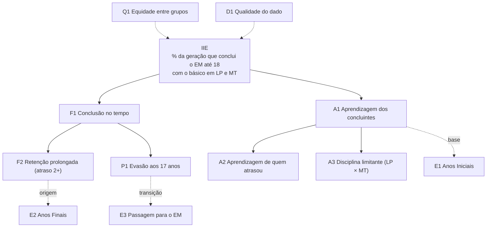
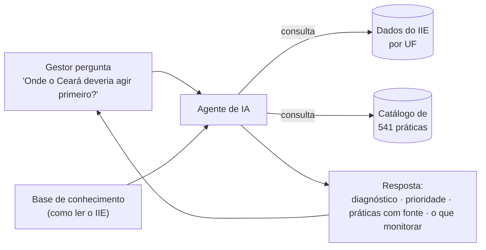
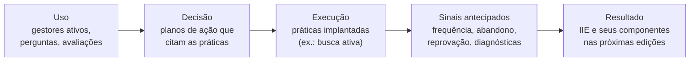

# IIE Conselheiro: visão de negócio

> Documento de análise de negócio · versão 1.0 · 10 de novembro de 2026
> Projeto da Lupa Social com o Instituto Natura.
> Para parceiros, financiadores, secretarias de educação e equipe do projeto.

## Sumário

1. [O problema: tecnologia e dados não chegam igual a quem decide](#1-o-problema-tecnologia-e-dados-não-chegam-igual-a-quem-decide)
2. [O que é o IIE](#2-o-que-é-o-iie)
3. [IIE Conselheiro: do indicador à ação](#3-iie-conselheiro-do-indicador-à-ação)
4. [Para quem é e que valor entrega](#4-para-quem-é-e-que-valor-entrega)
5. [Como funciona para o usuário](#5-como-funciona-para-o-usuário)
6. [Situação atual e próximos passos](#6-situação-atual-e-próximos-passos)
7. [Como medir o sucesso](#7-como-medir-o-sucesso)
8. [Premissas, limites e riscos](#8-premissas-limites-e-riscos)
9. [Fontes e documentos relacionados](#9-fontes-e-documentos-relacionados)

---

## 1. O problema: tecnologia e dados não chegam igual a quem decide

### 1.1 Um país com capacidades muito desiguais

A educação pública brasileira é gerida por 5.570 municípios, 26 estados e o Distrito Federal. A Constituição divide o trabalho: os municípios atuam prioritariamente na educação infantil e no ensino fundamental; os estados, no ensino fundamental e no médio. Cada rede, grande ou pequena, precisa planejar, acompanhar resultados e corrigir o rumo.

A capacidade de usar tecnologia para isso, porém, é muito desigual. Quase metade dos municípios do país (2.495, ou 44,8%) tem até 10 mil habitantes (IBGE, Censo 2022). É nesses lugares que a estrutura digital da gestão é mais frágil:

| Porte do município | Prefeituras com área de TI própria | Usaram inteligência artificial nos últimos 12 meses | Capacitaram funcionários em IA generativa |
|---|---:|---:|---:|
| Até 10 mil habitantes | 33% | 22% | 11% |
| De 10 mil a 100 mil | 58% | 27% | 15% |
| De 100 mil a 500 mil | 90% | 54% | 27% |
| Mais de 500 mil | 96% | 85% | 53% |
| **Total de prefeituras** | — | **27%** | **14%** |

*Fonte: Cetic.br/NIC.br, TIC Governo 2025, principais resultados (jul/2026). Coleta de julho de 2025 a abril de 2026, com 3.253 prefeituras.*

**Leitura**
- **Nos municípios menores, só 1 em cada 3 prefeituras tem área de TI.** Entre as que não têm, 70% dependem de profissionais terceirizados e só 14% contam com servidores concursados de TI.
- **Capitais e interior vivem realidades diferentes.** Têm área de TI 96% das capitais e 49% das prefeituras do interior. Usaram IA no último ano 81% das capitais e 26% do interior.
- **A distância cresce com as tecnologias mais novas.** Entre o maior e o menor porte, a diferença é de quase 4 vezes no uso de IA (85% contra 22%) e de quase 5 vezes na capacitação em IA generativa (53% contra 11%).

### 1.2 O gargalo não é só a ferramenta: é a fluência em dados

Ter acesso a dados não é o mesmo que saber usá-los. **Fluência em dados** é a capacidade de:
- ler um indicador;
- entender o que ele mede e o que não mede;
- compará-lo com uma referência;
- achar a causa provável;
- transformar essa leitura numa decisão.

A mesma pesquisa mostra que essa é a principal barreira:
- **O motivo mais citado pelas prefeituras para não usar IA é a falta de pessoas capacitadas (40%).** Em seguida vêm "não é uma prioridade" (36%) e dificuldades com a disponibilidade ou a qualidade dos dados (35%).
- **Onde há uso, ele ainda é operacional.** Só 14% das prefeituras usaram IA para apoiar a formulação, a implementação ou a avaliação de políticas públicas. Só 7% a usaram para predição e análise de dados.

> A TIC Governo mede a prefeitura como um todo, não a secretaria de educação em separado. A secretaria de educação, porém, depende da mesma estrutura de TI, dos mesmos contratos e das mesmas equipes. Num município pequeno, quem analisa os dados educacionais costuma ser o próprio dirigente ou um técnico que acumula várias funções.

### 1.3 Como isso afeta a gestão da educação pública

A educação é uma das áreas com mais dados públicos no Brasil:
- o Censo Escolar, todos os anos;
- o SAEB, a cada dois anos;
- o IDEB;
- a PNAD Contínua;
- painéis do MEC, de fundações e de institutos.

O problema não é a falta de dado. É a **distância entre o dado e a decisão**:

| Sintoma | O que acontece na prática | Consequência |
|---|---|---|
| **Painel sem orientação** | O gestor vê que um indicador piorou, mas o painel não diz por quê nem o que fazer | O dado vira relatório, não decisão |
| **Indicador lido fora de contexto** | A média de uma série escolar, como o SAEB do 3º ano do EM, pode cair quando mais jovens atrasados chegam ao fim do ensino médio, mesmo que a geração esteja aprendendo mais. É o chamado efeito de composição | Políticas que funcionam são abandonadas e políticas que não funcionam são mantidas |
| **Prioridade por percepção** | Sem decompor o problema, a gestão ataca o que é mais visível, não o que mais pesa | Esforço e orçamento no lugar errado |
| **Conhecimento disperso** | As boas práticas existem, mas em documentos longos. Só os três referenciais usados neste projeto somam 541 práticas | Quem decide não tem tempo de cruzar cada indicador com as práticas certas |
| **Rotatividade das equipes** | Cada troca de governo renova as secretarias. O próximo ciclo estadual começa em 1º de janeiro de 2027 | A memória técnica se perde e o diagnóstico recomeça do zero |

**Exemplo: errar a prioridade custa caro.** O Amazonas teve IIE de 7,7 em 2019. Se cada componente chegasse à média do Brasil, o índice ganharia:
- **+9,6 pontos** com a aprendizagem dos concluintes;
- +0,5 ponto com a retenção (atraso de 2 anos ou mais);
- +0,1 ponto com a evasão.

Uma gestão que concentrasse o esforço só em evasão atacaria o componente de menor retorno. O painel mostra os três números, mas não faz essa conta pelo gestor.

A desigualdade de capacidade se soma à desigualdade educacional. Os estados com menor IIE se concentram no Norte e em parte do Nordeste. Em todas as regiões, as redes municipais respondem pela educação infantil e por boa parte do ensino fundamental, inclusive a alfabetização. É ali que nasce boa parte da exclusão que o IIE mede no fim do ensino médio. **Quem mais precisa de apoio para ler e agir sobre os dados costuma ser quem menos tem estrutura para isso.**

---

## 2. O que é o IIE

### 2.1 Definição

O **Índice de Inclusão Educacional (IIE)** é a porcentagem dos jovens nascidos num mesmo ano que **concluíram o ensino médio até os 18 anos** e com **aprendizagem mínima** em Língua Portuguesa **e** em Matemática: o nível básico, 300 pontos no SAEB. Vai de 0 a 100 e responde a uma pergunta simples:

> *De cada 100 jovens desta geração, quantos terminaram a educação básica no tempo certo e aprendendo o essencial?*

### 2.2 O que a metodologia avalia

O IIE junta, num único número, quatro dimensões da trajetória escolar de uma geração:

| Dimensão | Como entra no índice | Fonte |
|---|---|---|
| **Acesso e permanência** | Quem saiu da escola continua contado na geração; não "some" da estatística | PNAD Contínua (IBGE) |
| **Fluxo** | Só conta quem concluiu até os 18 anos | Censo Escolar (INEP), com microdados identificados |
| **Conclusão** | É preciso ter sido aprovado na série final do ensino médio | Censo Escolar (INEP) |
| **Aprendizagem** | É preciso ter pelo menos 300 pontos em LP **e** em MT | SAEB, 3ª série do EM (INEP) |

### 2.3 Por que acompanhar gerações, e não séries

Indicadores tradicionais, como o SAEB e o IDEB, comparam a mesma série escolar ao longo do tempo. Quando o fluxo melhora, mais jovens com trajetória irregular chegam ao fim do ensino médio. A média da série cai, mesmo que a geração esteja mais bem educada.

O IIE acompanha a **geração inteira**, inclusive quem atrasou ou saiu da escola. Por isso ele capta melhorias que os indicadores de série escondem. O estudo de referência mostra que, de 2005 a 2017, o SAEB do ensino médio ficou praticamente estagnado. No mesmo período, a inclusão da geração cresceu, sobretudo entre os jovens com menor desempenho.

Três vantagens:
1. **incorpora a evasão**;
2. **é fácil de comunicar**, porque é uma porcentagem de pessoas;
3. **dá uma visão integrada** de toda a educação básica.

### 2.4 Em quais territórios

| Território | Situação | Observação |
|---|---|---|
| **Brasil** | Série oficial bienal de 2007 a 2019 | Painel público e estudos de 2024 |
| **27 unidades da federação** | Série oficial bienal de 2007 a 2019 (de 2013 a 2019 por etapa) | É a base de dados atual do IIE Conselheiro |
| **Capitais** | Em validação | Disponível no painel da Lupa Social |
| **Municípios (IIEM)** | Edição de 2017, com 4.775 municípios | Método adaptado: a PNAD não é representativa por município, então a evasão é estimada pelas matrículas |
| **Etapas do ensino fundamental** | Anos Iniciais (corte de 250 pontos) e Anos Finais (corte de 275) | Mostra onde a exclusão começa |
| **Recortes** | Sexo, raça/cor e disciplina | Disponíveis no painel público |

A família de índices também usa outras réguas de aprendizagem: **Pré-Inclusão** (250 pontos) e **Sucesso Educacional** (375).

### 2.5 O que o IIE mostra sobre o Brasil

- **A exclusão é a regra.** Em 2019, só **19 de cada 100 jovens** brasileiros estavam incluídos. Mesmo em São Paulo, o melhor estado (27,0), 73 de cada 100 não estavam.
- **A desigualdade regional é grande.** O maior IIE (SP, 27,0) é **4,2 vezes** o menor (AP, 6,5). Centro-Sul e Distrito Federal lideram; Norte e parte do Nordeste ficam no fim da lista. Ceará (21,2) e Pernambuco (19,3) são as exceções nordestinas acima da média nacional.
- **A exclusão se acumula ao longo da escola.** No Brasil, o índice cai de 52,4 nos Anos Iniciais para 24,7 nos Anos Finais e 19,0 no fim do ensino médio.
- **A geração se perde em dois pontos.** Em 2019:
  - 62,6% concluíram o ensino médio até os 18 anos;
  - 31,0% seguiam atrasados dois anos ou mais;
  - 6,4% estavam fora da escola sem o ensino médio;
  - entre os que concluíram no tempo, só **29,8%** tinham o básico em LP e MT.
- **Cada território tem um gargalo diferente:**

| Perfil | Estados (2019) |
|---|---|
| Fluxo e aprendizagem acima do Brasil | SP, DF, GO, PR, MG, CE |
| Gargalo de fluxo: aprendem, mas muitos atrasam | ES, RJ, MS |
| Gargalo de aprendizagem: concluem no tempo, mas aprendem pouco | PE, SC, MT |
| Gargalo duplo | RS e 14 estados do Norte e do Nordeste |

### 2.6 Por que o IIE importa: o que ele antecipa

Os estudos produzidos com o índice mostram que gerações com IIE mais alto têm, anos depois:
- **menos pobreza aos 23 anos:** cada ponto a mais de IIE se associa a 0,83 ponto percentual a menos de pobreza;
- mais ingresso e conclusão no ensino superior;
- mais ocupação de qualidade;
- menos jovens que não estudam nem trabalham;
- menos gravidez na adolescência, óbitos evitáveis e homicídios.

O IIE, portanto, não é só um indicador educacional. É um **indicador antecedente do desenvolvimento social** do território.

### 2.7 Quem está por trás

| Instituição | Papel |
|---|---|
| **Instituto Natura** | Patrocinador do IIE e criador da versão municipal (IIEM) |
| **Metas Sociais** (Reynaldo Fernandes, ex-presidente do INEP, e Fabiana de Felicio) | Desenvolveu a metodologia a pedido do Instituto Natura e produziu a série 2007–2019 |
| **Lupa Social** | Mantém o cálculo, o painel público e a expansão para capitais e municípios; conduz o IIE Conselheiro |

---

## 3. IIE Conselheiro: do indicador à ação

### 3.1 A proposta em uma frase

O IIE Conselheiro é um **agente de inteligência artificial** que conversa com gestores da educação. Ele **explica os resultados do IIE do território** do gestor e **orienta práticas de gestão**, com fonte, para melhorar os indicadores que estão mal.

O painel responde **"como estamos?"**. O Conselheiro responde também **"por quê?"**, **"onde agir primeiro?"**, **"o que fazer?"** e **"como saber se está funcionando?"**.

### 3.2 O que o projeto acrescenta à metodologia do IIE

Para orientar ações, o projeto evoluiu a metodologia do IIE em seis frentes:

**1. Decomposição exata do índice.** O IIE é o produto do fluxo pela aprendizagem:

> **IIE = (100 − F2 − P1) × A1 / 100**
>
> - **P1:** evasão, a parcela da geração fora da escola sem o ensino médio.
> - **F2:** retenção prolongada, a parcela que segue na escola com 2 anos ou mais de atraso.
> - **A1:** aprendizagem, a parcela com o básico em LP e MT entre os que concluíram no tempo.
>
> No Brasil, em 2019: (100 − 31,0 − 6,4) × 29,8% ≈ 18,6. O valor oficial é 19,0.

**2. Árvore de indicadores.** O índice se desdobra em 11 indicadores que apontam a causa:

**3. Semáforo.** Cada indicador recebe uma cor:
- 🟢 igual ou melhor que o Brasil;
- 🟡 atenção: pior que o Brasil;
- 🔴 crítico: entre as cerca de 7 piores UFs.

**4. Ganho potencial.** Para cada componente, o Conselheiro calcula quantos pontos o IIE ganharia se o território chegasse à média do Brasil. É o que transforma o diagnóstico em **prioridade**, como no exemplo do Amazonas (seção 1.3).

**5. Perfis de território.** Cada perfil tem uma sequência de ação recomendada:
- gargalo de fluxo;
- gargalo de aprendizagem;
- gargalo duplo;
- evasão alta;
- perda no ensino médio;
- dado inconsistente.

**6. Tempo de resposta.** O IIE mede o fim do ensino médio, então uma ação demora a aparecer no índice. O Conselheiro diz quando esperar resultado e o que acompanhar enquanto isso:

| Onde a ação atua | Quando aparece no IIE | O que acompanhar antes |
|---|---|---|
| Ensino médio (15 a 18 anos) | 0 a 3 anos | Frequência, abandono, casos de busca ativa |
| Anos Finais (11 a 14 anos) | 4 a 7 anos | Reprovação, distorção idade-série, IIE dos Anos Finais |
| Anos Iniciais e alfabetização (6 a 10 anos) | 8 a 11 anos | Avaliações diagnósticas, IIE dos Anos Iniciais |

### 3.3 A base de conhecimento: as boas práticas da educação pública

As orientações vêm de **três referenciais públicos de gestão educacional**. Eles foram inventariados prática a prática, com a referência exata no documento de origem:

| Visão | Documento | Autor | Para quem | Práticas |
|---|---|---|---|---:|
| **Gestão escolar** | Referencial para Qualidade e Equidade da Gestão Escolar | MEC (2026) | Direção da escola e papel da secretaria no acompanhamento das escolas | 372 |
| **Gestão da secretaria** | Secretaria Municipal de Educação: Práticas para uma boa gestão | Fundação Itaú / Itaú Social (2021) | Secretaria no início da gestão: equipe, funcionamento, ano letivo, plano | 117 |
| **Gestão estratégica** | Planejamento Estratégico de uma Secretaria de Educação | Todos Pela Educação | Ciclo de planejamento: diagnóstico, metas, prioridades, plano, monitoramento | 52 |
| | | | **Total** | **541** |

Cada indicador do IIE foi ligado às práticas que atuam sobre ele, em três níveis. Exemplos:

| Indicador | Escola | Secretaria | Estratégico |
|---|---|---|---|
| **P1 Evasão** | Monitorar a trajetória de cada estudante; busca ativa estruturada; prevenção ao abandono | Plataforma Busca Ativa Escolar; alerta precoce de desengajamento; busca ativa com Saúde e Assistência Social | Incluir o acesso entre os 3 a 5 objetivos prioritários da gestão |
| **F2 Retenção** | Recomposição das aprendizagens; condições para concluir no tempo | Recuperação contínua, e não só no fim do semestre; revisão dos critérios de promoção | Diagnóstico de trajetória, com meta |
| **A1 Aprendizagem** | Observação de aula com devolutiva; formação em serviço; discutir os resultados das avaliações | Priorizar habilidades essenciais (Mapas de Foco); núcleo de apoio às escolas | Análise da causa raiz da baixa aprendizagem |

Além das práticas por indicador, a base registra duas coisas:
- **Base comum:** seis pré-condições sem as quais nenhuma ação se sustenta:
  - liderança escolar;
  - acompanhamento às escolas;
  - planejamento e metas;
  - monitoramento;
  - recursos;
  - coerência entre as políticas.
- **Lacunas dos referenciais:** o que eles não cobrem. Nenhum dos três trata do ensino médio nem de correção de fluxo para quem já acumulou atraso. O Conselheiro informa a lacuna e sugere um complemento, marcado como "fora dos referenciais, a validar".

### 3.4 Onde entra a inteligência artificial

A IA é o que permite levar tudo isso ao gestor **em forma de conversa**:
- em linguagem simples;
- no ritmo dele;
- ajustada ao seu território e ao seu cargo.

Ela não substitui a metodologia nem inventa dados. Cada parte tem um papel:

| Parte | Papel |
|---|---|
| **Base de dados do IIE** | Fonte única de todos os números. São consultas fixas, auditáveis e somente de leitura |
| **Catálogo de práticas** | Fonte única de todas as práticas citadas, com código e documento de origem |
| **Base de conhecimento** | Ensina ao agente como ler o IIE: metodologia, árvore de indicadores, cuidados de leitura e glossário |
| **Modelo de IA (Claude, da Anthropic)** | Entende a pergunta, escolhe as consultas, interpreta os resultados e explica |

**O que o agente sabe consultar**

| Consulta | Para que serve |
|---|---|
| Resultado do IIE | Nível, evolução e posição de um território |
| Decomposição | Os componentes, o semáforo, o ganho potencial e os alertas sobre a qualidade do dado |
| Comparação | Território contra o Brasil ou contra outros estados |
| Ranking | Posição entre as UFs |
| Práticas para um indicador | Práticas-núcleo e complementares nos três níveis, com as lacunas |
| Pacote por perfil | A sequência de ação e as práticas para cada perfil de território |
| Busca de práticas | Encontrar práticas por tema, como "busca ativa" ou "formação de diretores" |

**Regras de confiança**

| Regra | Por que importa |
|---|---|
| Todo número vem de uma consulta feita na conversa, nunca da memória do modelo | Elimina números inventados |
| Toda prática citada traz código e fonte (por exemplo, "Itaú Social, SM-79") | O gestor pode conferir no documento original |
| O agente informa ano, fonte e quando o número é uma reprodução, e não o valor oficial | Transparência sobre a origem do dado |
| Quando o dado tem problema conhecido, o agente avisa antes de interpretar | Evita decisões sobre dado ruim (ver o caso da Bahia, seção 8) |
| Cada resposta fica registrada com as consultas usadas e os números sem origem | Permite auditar o agente |
| Fora do tema de IIE e gestão educacional, o agente não opina | Mantém o foco e a neutralidade institucional |

### 3.5 Exemplo de conversa

**Gestor (secretaria estadual do Ceará):** *Como está o Ceará no IIE?*

**IIE Conselheiro:**
> **Ceará: IIE 2019 de 21,2** (7º entre as 27 UFs; Brasil: 19,0)
> De cada 100 jovens nascidos em 2002, 21 concluíram o ensino médio até os 18 anos com o básico em Português e Matemática.
> - Evolução: 10,7 (2013) → 7,8 (2015) → 13,5 (2017) → 21,2 (2019), o 3º maior avanço do país.
> - Ponto forte: 67% concluem no tempo (Brasil: 63%).
> - Ponto de atenção 🔴: 11,1% estão fora da escola sem o ensino médio. É o principal gargalo do estado.
>
> Quer sugestões de ações para reduzir a evasão?

**Gestor:** *Sim.*

**IIE Conselheiro:** responde com quatro práticas de secretaria para a evasão:
- implantar a Busca Ativa Escolar (Itaú Social, SM-79);
- criar um alerta precoce de desengajamento (SM-76);
- fazer busca ativa com Saúde e Assistência Social (SM-78);
- montar um núcleo que acompanhe a frequência e o abandono por escola (MEC, GE-SEC-68).

E fecha com o que acompanhar mês a mês:
- frequência por estudante;
- casos da busca ativa abertos e encerrados;
- abandono por série.

### 3.6 Painel e Conselheiro: o que muda

| | Painel de indicadores | IIE Conselheiro |
|---|---|---|
| Pergunta que responde | Como estamos? | Como estamos, por quê, onde agir primeiro e o que fazer |
| Interpretação | Fica a cargo do usuário | Feita com o usuário, em linguagem simples |
| Prioridade | Não indica | Ganho potencial por componente |
| Ação | Fora do escopo | Práticas com fonte, no nível de atuação do gestor |
| Qualidade do dado | Notas técnicas, quando existem | Alerta na própria resposta |
| Fluência em dados exigida | Alta | Baixa: o gestor pergunta como perguntaria a um especialista |
| Acompanhamento | Espera a próxima edição do índice | Indica sinais antecipados para acompanhar desde já |

O Conselheiro **não substitui o painel**: os dois se complementam. O painel é para explorar e comunicar; o Conselheiro é para entender e decidir.

---

## 4. Para quem é e que valor entrega

| Perfil | Necessidade principal | O que o Conselheiro entrega |
|---|---|---|
| **Secretário(a) estadual de educação e equipe dirigente** | Definir prioridades da rede e justificar escolhas | Diagnóstico do estado, prioridade pelo ganho potencial e pacote de ação por perfil de território |
| **Técnico(a) de secretaria** (planejamento, avaliação, apoio às escolas) | Transformar dados em plano de trabalho | Indicadores em detalhe, práticas de secretaria com fonte e sinais para monitorar |
| **Dirigente municipal de educação** | Entender o papel da rede municipal num indicador que mede o fim do ensino médio | A leitura das etapas que o município governa (Anos Iniciais, Anos Finais, transição para o EM) e as práticas correspondentes |
| **Diretor(a) escolar** | Saber o que fazer na escola | Práticas de gestão escolar do referencial do MEC ligadas ao problema do território |
| **Equipe da Lupa Social e do Instituto Natura** | Apoiar redes parceiras em escala | Um primeiro atendimento qualificado e disponível o tempo todo, com registro do que os gestores perguntam |

**Proposta de valor**
1. **Democratiza a análise.** A leitura que hoje exige um especialista em indicadores passa a estar ao alcance de qualquer gestor cadastrado, inclusive em redes sem equipe técnica.
2. **Encurta o caminho do dado à ação.** Diagnóstico, prioridade e práticas na mesma conversa.
3. **Ancora a decisão em evidência.** Números auditáveis e práticas de referenciais reconhecidos, com a fonte.
4. **Preserva a memória técnica.** O método fica no sistema, não depende de quem está na equipe.
5. **Custa pouco por uso.** Cerca de US$ 0,10 por pergunta, na média.

---

## 5. Como funciona para o usuário

1. **Cadastro no site:** nome, cargo, instituição, estado, município e aceite do termo de uso.
2. **Aprovação pela equipe do projeto.** O acesso é restrito a gestores e equipes da educação.
3. **Conversa com o Conselheiro:**
   - numa interface de chat, como as de assistentes de IA conhecidos;
   - com várias conversas guardadas;
   - com sugestões de perguntas já ajustadas ao estado do usuário.
4. **Acesso por estado.** Cada usuário vê os dados dos estados liberados para ele, começando pelo seu. O Brasil, a posição nacional do próprio estado e as práticas de gestão ficam sempre disponíveis.
5. **Avaliação das respostas** com 👍 ou 👎, com motivo opcional. Isso alimenta a melhoria contínua.
6. **Limite diário** de perguntas por usuário (padrão de 40), para controlar o custo.
7. **Privacidade:**
   - o sistema trabalha só com dados agregados e públicos, nunca com dados de estudantes;
   - o usuário pode excluir a própria conta, o que apaga conversas e histórico.

A primeira versão é um **site**. O **WhatsApp** entra numa fase seguinte, para alcançar gestores que usam o celular como principal ferramenta de trabalho. Segundo a mesma TIC Governo 2025, 64% das prefeituras de até 10 mil habitantes já atendem o cidadão por WhatsApp ou Telegram.

---

## 6. Situação atual e próximos passos

**Situação em 10 de novembro de 2026**
- **Camada de dados: concluída.** Inclui o IIE por UF, a decomposição, o semáforo, o catálogo das 541 práticas e a relação entre indicadores e práticas, com testes automatizados.
- **Agente: concluído e testado em homologação.**
- **Site: concluído e testado em homologação.** A jornada completa (cadastro → aprovação → pergunta → resposta) funciona contra o ambiente de homologação.

**Próximas fases**

| Fase | Período | Entrega |
|---|---|---|
| Base de conhecimento e avaliação | novembro e dezembro de 2026 | Base de conhecimento versionada. Avaliação com 85 perguntas de referência antes de cada liberação |
| Piloto interno | dezembro de 2026 | Uso pela equipe da Lupa Social e do Instituto Natura |
| Piloto com secretarias | 1º de fevereiro a 5 de março de 2027 | Pelo menos duas secretarias parceiras; decisão de expansão no fim do piloto |
| Canal WhatsApp | a partir de março de 2027 | O mesmo agente, acessível pelo WhatsApp |
| Evolução | depois do piloto | Dados de capitais e municípios, recortes de equidade, gráficos, mensagens proativas |

O piloto com secretarias fica para fevereiro por dois motivos:
- dezembro e janeiro são meses de recesso escolar;
- os novos governos estaduais tomam posse em 1º de janeiro de 2027, o que troca as equipes das secretarias.

Isso também é uma **oportunidade**: as novas equipes chegam justamente na fase de diagnóstico e planejamento, que é onde o Conselheiro mais ajuda.

---

## 7. Como medir o sucesso

**Critérios do piloto**

| Dimensão | Meta |
|---|---|
| Adoção | Pelo menos 30 usuários ativos de pelo menos 2 secretarias |
| Satisfação | Pelo menos 70% de avaliações 👍 |
| Exatidão | Nenhum erro numérico confirmado |
| Experiência | Início da resposta em até 8 segundos (mediana) |
| Custo | Até US$ 0,15 por pergunta, na média do mês |
| **Impacto** | **Pelo menos um plano de ação real construído com a orientação do Conselheiro** |

**Cadeia de impacto**

O sucesso de longo prazo não se mede pelo uso do agente, e sim pela melhoria dos indicadores. Como o IIE responde com atraso, o acompanhamento segue uma cadeia:

---

## 8. Premissas, limites e riscos

| Tema | Situação | Como o projeto lida |
|---|---|---|
| **Atualidade dos dados** | A série oficial vai até 2019. O IIE de 2021 ainda não foi publicado: o estudo de 2024 o considerou inviável só com dados públicos, e o cálculo depende dos microdados do Censo Escolar. O de 2023 depende do Censo Escolar 2024 | O agente sempre informa o ano do dado. Novas edições entram na base sem mudar o agente |
| **Dados municipais** | O cadastro pede o município, mas hoje o agente responde com os dados do estado | O agente avisa que o dado municipal ainda não está disponível. O município fica guardado para quando a base existir |
| **Quebras na série** | 2015 tem queda generalizada, e 2019 tem um salto ligado ao SAEB. A Bahia tem uma anomalia de registro na coorte de 2019 (queda de 77% nos concluintes registrados em 2020) | O agente emite um alerta sobre a qualidade do dado (indicador D1) antes de interpretar |
| **Cobertura dos referenciais** | Nenhum dos três trata do ensino médio nem de correção de fluxo. O do Itaú Social é de 2021 e tem práticas ligadas à pandemia | As lacunas estão mapeadas. O agente indica quando a orientação vem de fora dos referenciais |
| **Quem executa** | O IIE mede o fim do ensino médio, que é oferecido sobretudo pelas redes estaduais. Dois referenciais foram escritos para secretarias municipais | As práticas de secretaria valem por analogia para os estados. Para os municípios, o foco são as etapas do ensino fundamental e a transição para o ensino médio |
| **Confiança na IA** | Modelos de linguagem podem errar | Números e práticas só vêm de consultas auditáveis. As respostas são avaliadas antes de cada liberação, e cada resposta fica registrada |
| **A IA não decide** | A orientação é um apoio, não uma determinação | O agente apresenta opções com fonte. A decisão e a adaptação ao contexto local são do gestor |
| **Privacidade (LGPD)** | O sistema guarda o cadastro e as conversas dos usuários | Só dados agregados e públicos sobre educação; termo de uso; exclusão da conta pelo próprio usuário |
| **Adoção** | Troca de equipes em 2027 e baixa fluência digital em parte das redes | Piloto acompanhado, linguagem simples, sugestões de perguntas prontas e, depois, o WhatsApp |

---

## 9. Fontes e documentos relacionados

**Dados citados neste documento**
- Cetic.br/NIC.br. *Pesquisa sobre o uso das tecnologias de informação e comunicação no setor público brasileiro: TIC Governo 2025*. Principais resultados, 23 jul. 2026. [Apresentação](https://cetic.br/media/pdf/analises/20260803083915_pt_br_tic_governo_2025_lan%C3%A7amento_imprensa_v3.pdf).
- IBGE. *Censo Demográfico 2022: primeiros resultados* (jun. 2023): 2.495 municípios (44,8%) com até 10 mil habitantes. [Reportagem](https://www.band.com.br/noticias/censo-2022-448-dos-municipios-do-brasil-tem-ate-10-mil-habitantes-16612900).
- Fernandes, R.; Felicio, F.; Saad, D. *A Evolução do Desempenho Educacional dos Jovens Brasileiros ao Final da Educação Básica*. Instituto Natura e Metas Sociais, 2024. Tabela 7: IIE por UF de 2013 a 2019. Arquivo em [estudos/](../estudos/).
- Estudos *IIE e Pobreza* (Lupa Social), *Relação entre IIE e Indicadores Socioeconômicos* (Metas Sociais, 2024) e *IIE Municipal* (Instituto Natura). Arquivos em [estudos/](../estudos/).
- Painel público do IIE: [Looker Studio](https://lookerstudio.google.com/s/lAHnTj0l5K4).

**Referenciais de boas práticas** (em [boas-praticas/](../boas-praticas/))
- MEC. *Referencial para Qualidade e Equidade da Gestão Escolar*, 2026.
- Fundação Itaú / Itaú Social. *Secretaria Municipal de Educação: Práticas para uma boa gestão*, 2021.
- Todos Pela Educação. *Planejamento Estratégico de uma Secretaria de Educação*.

**Documentos do projeto**
- [contexto/](../contexto/): visão geral, metodologia, resultados por território e estudos do IIE.
- [contexto/09_indicadores_iie_e_praticas_de_gestao.md](../contexto/09_indicadores_iie_e_praticas_de_gestao.md): árvore de indicadores, semáforo por UF e práticas por indicador.
- [03_proposta_sistema_web.md](03_proposta_sistema_web.md): arquitetura do site e do agente.
- [02_plano_desenvolvimento.md](02_plano_desenvolvimento.md): fases, cronograma e orçamento.

Contato: contato@educacional.ia.br
